# AI Fundamentals: A Reading Guide (v2)

*Built for Jarrod Tran, Nov 11, 2026. Second edition of the Oct 18, 2026 guide. Read at your own pace. There are no quizzes.*

This guide explains the ideas behind the AI tools you use every day: what a model is, how it reads text, how it "thinks," how fast and expensive it is, how it connects to your apps, where it goes wrong, how it gets measured, and where it can run. Every section opens with a **Key idea** box, then explains how the thing works and what it changes for you in practice. Each section ends with the sources it draws on. All diagrams are drawn for this guide. When a chart uses made-up numbers to show a shape, it is labeled **example**. When it uses measured or published numbers, it names where they came from.

**What's new in v2.** Eight new sections: reasoning models, prompting and context engineering, function calling and MCP, hallucinations, named benchmarks and test leakage, images and other inputs, safety and prompt injection, and running models locally. Every v1 fact was rechecked against its source on Nov 11, 2026. The biggest corrections: Artificial Analysis changed how it measures speed on Nov 3, 2026 (Section 7), flagship context windows are now about 1 million tokens (Section 3), Anthropic's API now rejects temperature settings (Section 6), and its Intelligence Index was rebuilt (Section 13).

**How the guide was built.** The backbone is Andrej Karpathy's most-watched YouTube lectures, checked against their transcripts, plus 3Blue1Brown's visual lesson on transformers. Primary documents pin terms down exactly: vendor docs, official specifications, benchmark methodology pages, and the original papers. Stanford CS336 and MIT 6.S191 were used to check the order of topics. Token counts were measured for this guide with OpenAI's `tiktoken` library.

## 1. What an LLM actually is

> **Key idea.** A large language model (LLM) is a program that, given some text, predicts which small piece of text should come next. Every chatbot answer is that one prediction run over and over.

3Blue1Brown's lesson puts it this way: the model takes in text and produces "a prediction of what comes next, in the form of a probability distribution over all chunks of text that might follow." To write a longer answer, the system picks one piece from those odds, adds it to the text, and asks again. "This process of repeated prediction and sampling is essentially what's happening when you interact with ChatGPT and see it producing one word at a time."

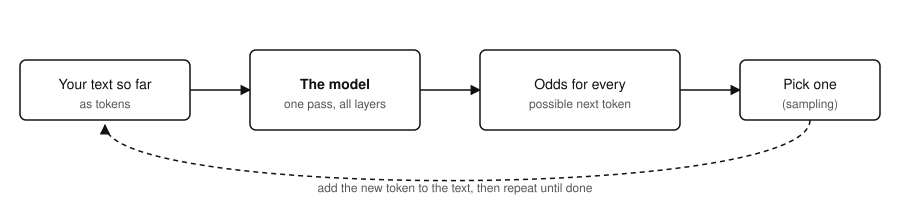

*Figure 1. The loop behind every chatbot answer: predict, pick, append, repeat.*

**What happens inside, in four steps** (from the 3Blue1Brown lesson):

1. **Tokens.** The input is cut into chunks called tokens (Section 2).
2. **Vectors.** Each token is turned into a long list of numbers, called a vector or embedding. Tokens with similar meanings end up with similar vectors (Section 8).
3. **Attention.** The vectors "communicate with each other to update their values based on context." The word *model* means something different in "a machine learning model" than in "a fashion model," and attention is the step that works out which nearby words should change the meaning of which.
4. **Feed-forward layers.** Each vector then goes through the same operation on its own. The model alternates attention and feed-forward layers many times. At the end, it turns the last vector into odds for every possible next token.

**Two helpful ways to think about it**, from Karpathy's *Deep Dive into LLMs like ChatGPT*:

- **A lossy zip file of the internet.** Talking about a 405-billion-parameter model, Karpathy says the parameters are "a kind of compression of the internet," like a zip file, but "not a lossless compression," a lossy one. The model keeps patterns and the general sense of things, not exact copies. That's why it can be fluent and still get a specific fact wrong (Section 12).
- **Swiss-cheese abilities.** Models are "incredibly good across so many different disciplines but then fail randomly almost in some unique cases." His examples are counting the letters in a word, or saying 9.11 is bigger than 9.9. Once you see tokens in Section 2, a lot of these failures make sense.

**What this means in practice**

- The model doesn't look facts up unless the software around it gives it a search tool (Sections 8, 10, and 11). Out of the box, it answers from what it compressed during training.
- The same prompt can get different answers, because the next piece is *picked* from a set of odds (Section 6).
- Answers come out one token at a time, so speed is counted in tokens per second (Section 7).

*Sources: [3Blue1Brown: Transformers, the tech behind LLMs](https://www.3blue1brown.com/lessons/gpt/); [Karpathy: Deep Dive into LLMs like ChatGPT](https://www.youtube.com/watch?v=7xTGNNLPyMI); [Karpathy: Intro to Large Language Models](https://www.youtube.com/watch?v=zjkBMFhNj_g).*

## 2. Tokens and tokenization

> **Key idea.** A token is the unit of text a model reads and writes: usually a whole word, part of a word, a punctuation mark, or a space plus a word. Prices, limits, and speeds are all counted in tokens, not words.

OpenAI's help article gives the standard rules of thumb for English: 1 token is about 4 characters, or about three-quarters of a word, so **100 tokens is roughly 75 words**. The article calls these "estimates, not exact counts," and adds that "other languages can have different relationships between characters, words, and tokens." For exact counts you run the model's own tokenizer, such as OpenAI's `tiktoken` library.

**Why models use tokens instead of letters or whole words.** A tokenizer learns a fixed vocabulary of common chunks. Karpathy's Deep Dive uses the GPT-4 tokenizer, which has **100,277** possible tokens (we confirmed this with `tiktoken`: the `cl100k_base` vocabulary has 100,277 entries; the newer `o200k_base` has 200,019). For each next token, the network outputs one score for every entry. Using chunks instead of single letters makes text much shorter for the model, which matters because every token costs compute, time, and money. A fixed vocabulary also means any text can be written, including words the model has never seen, by splitting them into smaller pieces.

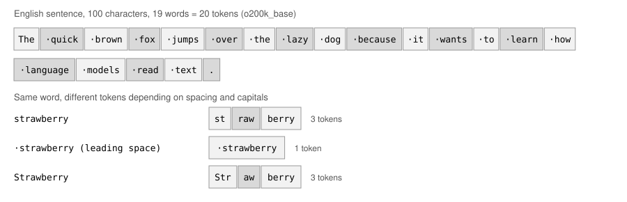

*Figure 2. Real output from OpenAI's o200k_base tokenizer, re-run for this edition. A dot (·) marks a leading space.*

**What the figure shows.** Common English words are usually one token each, and the space is part of the token (" quick"). The word "strawberry" is one token when a space comes before it, but three tokens (st / raw / berry) at the start of a line, and a different three (Str / aw / berry) with a capital S. OpenAI's article makes the same point: "A word can be divided into different tokens depending on its spelling, capitalization, and surrounding text." The model sees token IDs, not letters. That's why Karpathy's Swiss-cheese examples, like counting the r's in "strawberry," trip models up: the letters were never separate inputs.

**Languages, numbers, and code split differently.** We counted the same sentence in three languages with the same tokenizer. The exact sentences are in the table so you can re-run them.

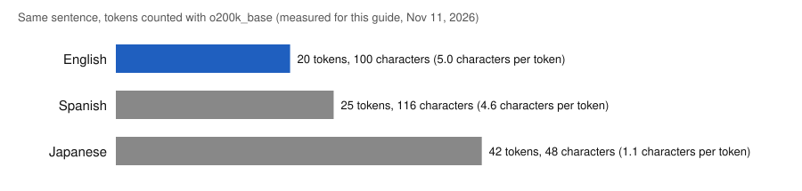

*Figure 3. Measured for this guide with o200k_base. The same meaning costs about twice as many tokens in Japanese as in English.*

| Text | Characters | Tokens | Note |
|---|---|---|---|
| English: "The quick brown fox jumps over the lazy dog because it wants to learn how language models read text." | 100 | 20 | about 5 characters per token |
| Spanish: "El rápido zorro marrón salta sobre el perro perezoso porque quiere aprender cómo los modelos de lenguaje leen texto." | 116 | 25 | words split into pieces more often (z / orro, marr / ón, p / erez / oso) |
| Japanese: "素早い茶色のキツネは、言語モデルがどのように文章を読むのかを学びたいので、怠惰な犬を飛び越える。" | 48 | 42 | many single characters are a token each |
| `Order 4,812,337 units at $19.99 each on 2026-10-18.` | 51 | 23 | numbers split into chunks of up to 3 digits |
| 2 lines of Python: `def greet(name):` / `return "Hello, " + name + "!"` | 50 | 15 | common code patterns pack well |

**Reasoning tokens are tokens too.** OpenAI's article now lists four kinds: input tokens, output tokens, cached input tokens, and reasoning tokens. "Reasoning tokens are not visible as answer text, but they count toward output usage and are billed as output tokens. A short visible answer can therefore use more tokens than its displayed text suggests." Section 5 explains where those tokens come from.

**What this means in practice**

- **Cost and limits are counted in tokens, not words.** Vendors price per million tokens and size context windows in tokens. The same document can cost more in another language.
- **Different models use different tokenizers.** OpenAI: "The same text can produce different token counts depending on the model, its encoding, and the language." So "price per million tokens" isn't directly comparable across vendors (Section 7).
- **Spelling, letter counting, and digit-by-digit math are harder than they look** for the model, because its units don't line up with letters or digits. Karpathy's advice is to let the model use tools, like running code, for this kind of work.

*Sources: [OpenAI: Understanding and counting tokens](https://help.openai.com/en/articles/4936856-what-are-tokens-and-how-to-count-them); [Karpathy: Let's build the GPT Tokenizer](https://www.youtube.com/watch?v=zduSFxRajkE); [Karpathy: Deep Dive](https://www.youtube.com/watch?v=7xTGNNLPyMI); token counts measured for this guide with `tiktoken` (o200k_base and cl100k_base).*

## 3. Context windows and context rot

> **Key idea.** The context window is the most text, counted in tokens, that a model can work with in one request: instructions, files, the whole conversation, and the reply. Flagship models now accept about 1 million tokens, but more context is not automatically better.

Karpathy calls the context window "the working memory of the model." Text inside it "directly feeds into the neural network so it's not anymore a vague recollection." Knowledge from training is the hazy zip file from Section 1. Text in the window is right in front of the model. He compares a model running a web search to a person looking something up: "you're refreshing your working memory." Anthropic's docs use the same picture: the context window "represents a 'working memory' for the model," and it includes "the response itself."

**How big are they now?** In the Deep Dive (early 2025), Karpathy calls GPT-2's 1,024-token context tiny and says modern context lengths are "closer to a couple hundred thousand or maybe even a million" tokens. In November 2026, vendor model pages put the flagships at the top of that range:

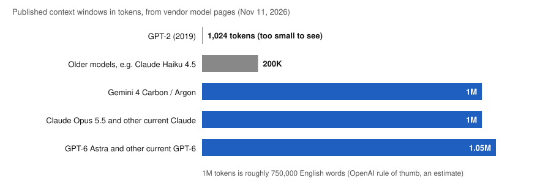

*Figure 4. Published limits from each vendor's model page, Nov 11, 2026. GPT-2's 1,024 tokens is too small to see at this scale.*

| Vendor (model page) | Current models | Context window | Max output |
|---|---|---|---|
| OpenAI | GPT-6 Astra, GPT-6.1 Sol, GPT-6.1 Terra, GPT-6 Luna | 1.05M tokens | 128K tokens |
| Anthropic | Claude Fable 5.2, Opus 5.5, Sonnet 5.5, Haiku 5.5 | 1M tokens | 128K tokens |
| Google | Gemini 4 Carbon, Gemini 4 Argon | 1M tokens | listed as "65K / 1M tokens" |
| Older models still offered | e.g. Claude Opus 4.5, Sonnet 4.5, Haiku 4.5 | 200K tokens | 64K tokens |

Using the rule of thumb from Section 2, 1 million tokens is roughly 750,000 English words (an estimate). Google's long-context page describes 1 million tokens as about "50,000 lines of code (with the standard 80 characters per line)" or "8 average length English novels."

**What actually fills it.** People think of the window as "my prompt," but in a chat app it also holds the hidden system prompt, definitions of every tool the model can call, documents you uploaded or the app retrieved, every earlier turn (yours and the model's), any reasoning tokens the model writes (Section 5), and the reply itself. Section 9 draws this as a budget.

**Context rot.** A bigger window doesn't mean the model uses all of it equally well. Anthropic's context-windows page: "more context isn't automatically better. As token count grows, accuracy and recall degrade, a phenomenon known as context rot. This makes curating what's in context just as important as how much space is available." Its context-engineering article says this "emerges across all models," with some degrading more gently than others.

Google's long-context page sounds more upbeat at first: for a large chunk of text, "the model is highly capable of extracting that information (up to 99% accuracy in many cases)." Read the next part, though. That figure is for finding one specific piece of information. When you need many pieces, Google says the model "does not perform with the same accuracy," and suggests paying for a separate request per item if you need 99% on each. So the two vendors agree: **finding one fact in a long context works well; using lots of scattered facts from a long context gets worse as it grows.**

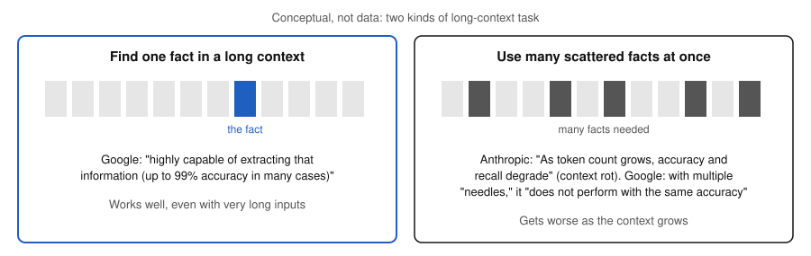

*Figure 5. Conceptual, not data. Both claims are true at once because they describe different tasks.*

**What happens when it's full.** The app might drop the oldest turns, summarize them (called **compaction**), or refuse the request. Anthropic defines compaction as "taking a conversation nearing the context window limit, summarizing its contents, and reinitiating a new context window with the summary." Its harness article says plainly: "However, compaction isn't sufficient." Their fix for long agent work was having the agent write progress notes to a file and read them back in a fresh session (Section 11).

**What this means in practice**

- **Start a new chat for a new task.** Old, unrelated turns take up space and can pull the model off track.
- **Ask questions at the end.** Google's FAQ: "the model's performance will be better if you put your query / question at the end of the prompt (after all the other context)."
- **Bigger isn't automatically better.** A 1M-token window lets you paste a whole contract, but putting in only the relevant parts (Sections 8 and 9) often works better and costs less, because you pay for every input token on every request.
- **Memory features are something the harness does.** When an app "remembers" you across chats, it's saving notes and putting them back into the window. The model itself doesn't change.

*Sources: [Karpathy: Deep Dive](https://www.youtube.com/watch?v=7xTGNNLPyMI); [Karpathy: How I use LLMs](https://www.youtube.com/watch?v=EWvNQjAaOHw); [OpenAI: Models](https://developers.openai.com/api/docs/models); [Anthropic: Models overview](https://platform.claude.com/docs/en/models/overview); [Google: Gemini models](https://aistudio.google.com/docs/models); [Anthropic: Context windows](https://platform.claude.com/docs/en/build-with-claude/context-windows); [Google: Long context](https://aistudio.google.com/docs/long-context); [Anthropic: Effective context engineering for AI agents](https://www.anthropic.com/research/effective-context-engineering-for-ai-agents); [Anthropic: Effective harnesses for long-running agents](https://www.anthropic.com/research/effective-harnesses-for-long-running-agents).*

## 4. Training vs inference, and what parameters are

> **Key idea.** Training builds a model by changing its internal numbers (parameters). Inference is using the model, and it only reads those numbers. Your chats don't change the model.

**Parameters (also called weights)** are the numbers inside the network. Training adjusts them, and inference reads them. When a model is described as "405B," it has about 405 billion parameters. Karpathy's example is Meta's Llama 3.1 405B base model. More parameters can hold more patterns, but they also take more memory and computing power to run (Sections 17 and 18).

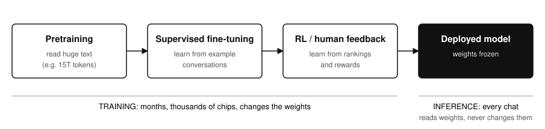

*Figure 6. The stages Karpathy walks through in the Deep Dive. The example figure comes from the FineWeb dataset he shows.*

**Stage 1: Pretraining.** The model learns to predict the next token across a huge amount of text. Karpathy's example is the FineWeb dataset: heavily filtered web text, "about 44 terabytes," which is "about a 15 trillion token sequence." That takes months on thousands of computers. The result is what he calls an "internet document simulator." It can continue any text, but it isn't an assistant yet.

**Stage 2: Supervised fine-tuning (SFT).** The model keeps training, this time on example conversations written to show how a helpful assistant should answer. The InstructGPT paper describes collecting "labeler demonstrations of the desired model behavior" and using them "to fine-tune GPT-3 using supervised learning."

**Stage 3: Reinforcement learning (RL), including learning from human feedback.** People rank several outputs, a scoring model learns from those rankings, and the main model is trained to earn higher scores. In InstructGPT, "outputs from the 1.3B parameter InstructGPT model are preferred to outputs from the 175B GPT-3, despite having 100x fewer parameters." How a model is trained after pretraining can matter more than its raw size. Karpathy points out a catch: when the scorer is itself a model, you're optimizing against "a lossy simulation of humans," and the main model can learn to exploit it. RL is also how reasoning models are made (Section 5).

**Fine-tuning, as you'll hear the word at work.** "Fine-tuning" usually means taking an existing model and training it further on your own examples, so it picks up a format, tone, or narrow task. That changes the weights. Retrieval (Section 8) doesn't: it adds information to the context at the moment you ask. Which vendors let you fine-tune which models, and what it costs, isn't covered here.

**Inference.** Karpathy: "in inference what we're doing is we're generating new data from the model." Each time you chat, the trained weights are read, never changed. That's why a model has a **knowledge cutoff**: it knows nothing that happened after its training data was collected, unless a tool or document puts that information in the context. Vendors publish these dates. Anthropic's model page, for example, lists a "Reliable knowledge cutoff" of Jun 2026 for its current models, and OpenAI's lists "Knowledge cutoff" dates such as Apr 30, 2026 for GPT-6 Astra.

**What this means in practice**

- **Your chat doesn't teach the model anything.** Within a chat, it only "learns" from what's in the context window. Whether a vendor later uses your data for training is a policy and contract question (Section 17).
- **"Bigger model" and "better model" aren't the same thing.** Post-training and reasoning ability matter a lot.
- **To change how it behaves, try prompting first, then retrieval, and fine-tuning last.** Each step costs more and is harder to undo than the one before.

*Sources: [Karpathy: Deep Dive](https://www.youtube.com/watch?v=7xTGNNLPyMI); [Ouyang et al. 2022, InstructGPT](https://arxiv.org/abs/2203.02155); [Anthropic: Models overview](https://platform.claude.com/docs/en/models/overview); [OpenAI: Models](https://developers.openai.com/api/docs/models); [Stanford CS336](https://cs336.stanford.edu/); [MIT 6.S191](https://introtodeeplearning.com/).*
## 5. Reasoning (thinking) models

> **Key idea.** A reasoning model writes out hidden working, called reasoning or thinking tokens, before it gives its answer. That makes it better at multi-step problems, and slower and more expensive, because you wait for and pay for those tokens. Current models decide for themselves how much to think, and you steer them with an effort setting.

**Why thinking helps.** Anthropic's thinking guide puts the problem simply: "A model that answers in a single pass has to get everything right on the first try: no scratch work, no checking, no changing approach halfway through." With thinking on, the model "restates what is being asked, tries approaches, checks intermediate results, and abandons paths that do not hold up," and then draws on that work for the final answer. Karpathy says the same thing from the other side: models "need tokens to think." A model forced to jump straight to the answer has nowhere to do the work. OpenAI's guide lists what the extra tokens buy: they help the model "plan, use tools effectively, inspect alternatives, recover from ambiguity, and solve harder multi-step tasks."

**How they're made.** Karpathy separates models trained mostly by imitation (supervised fine-tuning, Section 4) from "thinking models trained with RL." The clearest public account is the DeepSeek-R1 paper (2025, revised Jan 2026). Its claim: "the reasoning abilities of LLMs can be incentivized through pure reinforcement learning (RL), obviating the need for human-labeled reasoning trajectories." In other words, nobody has to write out example chains of reasoning. The model is rewarded for correct final answers on checkable problems, and useful habits appear on their own: the paper reports "the emergent development of advanced reasoning patterns, such as self-reflection, verification, and dynamic strategy adaptation." It also found these patterns "can be systematically harnessed to guide and enhance the reasoning capabilities of smaller models."

**What a reasoning request looks like over time.** The thinking comes first, then the answer. That's why benchmarkers now track two different "first token" times. Artificial Analysis defines **time to first token** as the wait for the first token of any kind, which "for reasoning models which return reasoning tokens, this will be the first reasoning token." Its newer **time to first answer token** "includes the time spent reasoning, so unlike time to first token, it measures the wait for an answer the same way for reasoning and non-reasoning models."

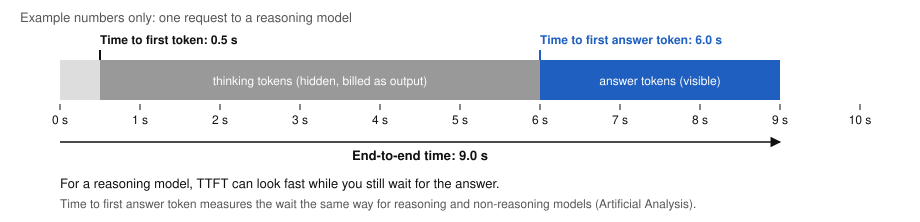

*Figure 7. Example numbers, not a measurement. Thinking tokens arrive first and are billed, even when you never see them.*

**Hidden, but billed and counted.** OpenAI: "While reasoning tokens are not visible via the API, they still occupy space in the model's context window and are billed as output tokens." Anthropic: "the tokens Claude spends reasoning are billed as output tokens, even when the thinking text isn't returned to you, and they count toward max_tokens alongside the response text." How many? OpenAI says "anywhere from a few hundred to tens of thousands of reasoning tokens," and recommends "reserving at least 25,000 tokens for reasoning and outputs when you start experimenting." If the limit is hit first, you can be charged "for input and reasoning tokens without receiving a visible response." Neither vendor shows the raw reasoning; both offer summaries of it.

**From fixed budgets to adaptive thinking and effort.** The first generation of thinking controls had you set a fixed token budget per request. Anthropic has retired that for new models: "Extended thinking (thinking.type: "enabled" with budget_tokens) is deprecated. Claude 4.7 and later models do not support it and reject requests that use it." The replacement is **adaptive thinking**: "Claude's thinking is adaptive: the model evaluates each request and determines whether to think and how much." A simple factual question "might get a direct response with no thinking block at all; a multistep math problem or a tricky debugging task triggers deeper reasoning." The main control is an **effort** level, which Anthropic calls "soft guidance for how often and how deeply Claude uses thinking." OpenAI's API has the same shape: you pass a `reasoning.effort` value, and its current flagship models list low, medium, high, xhigh, and max (GPT-6.1 Terra and GPT-6 Luna also offer "none").

| Anthropic effort level | What the docs say it does |
|---|---|
| low | "Claude minimizes thinking. Skips thinking for simple tasks where speed matters most." |
| medium | "Claude uses moderate thinking. Might skip thinking for simple queries." (default on Opus 5.5 and Haiku 5.5) |
| high | "Claude thinks on most requests that benefit from it." (default on most models) |
| xhigh | "Claude thinks more readily and at greater depth than at high" |
| max | "Claude thinks the most readily and at the greatest depth, with no constraint on thinking length." |

Anthropic adds that "No level guarantees a thinking block on every request," and that in a tool-use loop the first request after your message "typically carries most of the reasoning."

**When extra thinking is worth the cost and the wait**

#### Worth it
Problems where the answer depends on intermediate steps. Anthropic names "math, coding, analysis, and long-running agentic work." OpenAI names "complex problem solving, coding, scientific reasoning, and multi-step agentic workflows." Also: anything where a confident wrong answer is expensive. OpenAI reports that GPT-5 "has significantly fewer hallucinations especially when reasoning" (Section 12).
#### Usually not worth it
Simple lookups, rewording, short chat turns, and high-volume routine jobs where speed and cost matter most. Anthropic positions its smallest model "for high-volume, latency-sensitive tasks such as classification, extraction, and routing." Its own low effort level "skips thinking for simple tasks where speed matters most."
#### How to decide
Start at the default effort, then measure on your real tasks: quality, time to first answer token, and total tokens billed. Anthropic: "If you want Claude to think less often, lower the effort level before reaching for prompt-based steering."

**What this means in practice**

- **A slow first word isn't a broken app.** With a reasoning model, the wait before the answer is often thinking time you're paying for.
- **Judge cost per finished task, not per token.** A short answer can carry thousands of hidden reasoning tokens (Section 7).
- **Leave room in the limits.** If you cap output tokens too tightly, the model can run out mid-thought and return nothing useful.
- **Effort is the knob to turn,** not a token budget, on current Anthropic and OpenAI models.

*Sources: [DeepSeek-AI 2025, DeepSeek-R1](https://arxiv.org/abs/2501.12948); [OpenAI: Reasoning models](https://developers.openai.com/api/docs/guides/reasoning); [OpenAI: Models](https://developers.openai.com/api/docs/models); [Anthropic: Thinking](https://platform.claude.com/docs/en/build-with-claude/thinking); [Anthropic: Steering thinking](https://platform.claude.com/docs/en/build-with-claude/thinking-steering-and-cost); [Anthropic: Extended thinking](https://platform.claude.com/docs/en/build-with-claude/extended-thinking); [Anthropic: Models overview](https://platform.claude.com/docs/en/models/overview); [Artificial Analysis: performance benchmarking](https://artificialanalysis.ai/methodology/performance-benchmarking); [OpenAI: Why language models hallucinate](https://openai.com/index/why-language-models-hallucinate/); [Karpathy: Deep Dive](https://www.youtube.com/watch?v=7xTGNNLPyMI).*

## 6. Temperature and sampling

> **Key idea.** Temperature controls how adventurous the model is when it picks the next token from its odds. It's a real mechanism, but at least one major vendor, Anthropic, has now removed it from its API, so you may not get to set it.

The model gives every possible next token a score. Those scores are turned into odds, and one token is drawn. Hugging Face's guide explains that lowering the temperature makes the distribution "sharper (increasing the likelihood of high probability words and decreasing the likelihood of low probability words)." Raising it flattens the odds, so less likely tokens get picked more often.

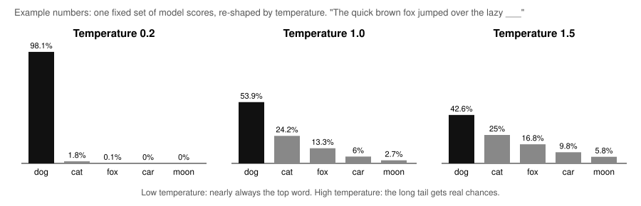

*Figure 8. Example numbers: five made-up scores, converted to odds at three temperatures with the standard formula. The shape is the point, not the exact values.*

**Other settings you'll see next to temperature** (also from Hugging Face's guide):

| Setting | What it does | When it helps |
|---|---|---|
| Temperature | Makes the odds sharper (lower) or flatter (higher) | Lower for facts, extraction, and code. Higher for brainstorming and creative writing. |
| Top-k | Only draws from the k most likely tokens | Cuts off strange low-odds picks |
| Top-p (nucleus) | Only draws from the smallest group of tokens whose odds add up to p | Like top-k, but the group grows or shrinks depending on how confident the model is |
| Greedy decoding | Always takes the single most likely token | Most repeatable, but can loop or sound flat |

**The settings are being taken away, and not just on thinking models.** v1 of this guide said some thinking models restrict these settings. That undersells what has happened at Anthropic. Its thinking docs now say that on current Claude models, "non-default temperature, top_p, or top_k values return a 400 error on every request, regardless of whether thinking is used." A 400 error means the request is rejected. Anthropic's migration guide for API version 2026-10-21 goes further, under the heading "Sampling parameters are removed":

> "In 2026-10-21, a request that sends temperature, top_p, or top_k returns a 400 error, even at the parameter's default value."

The same page says requests without them sample "with their defaults, including a temperature of 1.0," that "Models that already accept only the defaults, such as Claude 4.7 and later models, sample as before," and that on older models where you used a lower temperature for more consistent output, the request "loses that effect. No other setting replaces it." This guide found the removal documented by Anthropic only. Check your own vendor's current docs before relying on these settings.

**What this means in practice**

- **Getting different answers to the same question is normal.** The model is drawing from odds. Where you can still lower the temperature, answers get more consistent, but not guaranteed identical.
- **A low temperature doesn't make answers true.** It makes the model pick its top guess more reliably. If that top guess is wrong, you get the same wrong answer more consistently.
- **Plan for not having the knob.** If consistency matters, get it from clear instructions, fixed output formats, and checking results, not from a sampling setting the API may reject.

*Sources: [Hugging Face: How to generate text](https://huggingface.co/blog/how-to-generate); [Anthropic: Thinking (sampling parameters)](https://platform.claude.com/docs/en/build-with-claude/thinking); [Anthropic: Migrating to API version 2026-10-21](https://platform.claude.com/docs/en/api/migration-2026-10-21); [3Blue1Brown](https://www.3blue1brown.com/lessons/gpt/); [Karpathy: Deep Dive](https://www.youtube.com/watch?v=7xTGNNLPyMI).*

## 7. Speed and cost: latency, tokens per second, and price

> **Key idea.** How fast a response feels depends on the wait before the first useful token and the total time to the last one. What it costs depends on every token in and out, including hidden reasoning. Compare models on time and cost per finished task, not on per-token numbers from different vendors.

**How Artificial Analysis measures speed, as of Nov 3, 2026.** Artificial Analysis, an independent benchmarking firm, rewrote its method in version 3.0.0, dated 3 November 2026. Several definitions v1 of this guide relied on changed. The current ones:

| Measure | Artificial Analysis definition (v3.0.0) |
|---|---|
| Time to first token (TTFT) | "The time in seconds between sending a request to the service or system and receiving the first token of the response." For reasoning models, the first reasoning token. |
| Time to first answer token | The wait for the first token of the actual answer. "For reasoning models, this includes the time spent reasoning." |
| Output speed (tokens per second) | "The number of output tokens, including reasoning tokens, received per second over a request's full duration, from sending the request to receiving the final token, so it includes time to first token." |
| End-to-end time | "The time in seconds between sending a request and receiving the final token, measured on each request." |

**The big change: output speed now includes the wait.** Before, AA's output speed counted only the streaming part after the first token, and you could estimate total time as TTFT plus tokens divided by speed. Now AA's changelog says: "Output speed now covers each request's full duration, including time to first token." Adding TTFT again would count the wait twice. AA publishes end-to-end time directly instead. Other sites may still use the old meaning of "tokens per second," so check which one you're reading.

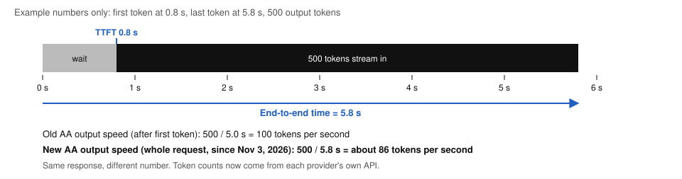

*Figure 9. Example numbers, not a measurement: one 500-token response, shown with the old and new ways of computing tokens per second.*

**Token counting changed too.** v1 said AA counts every model's tokens in one shared unit (OpenAI's o200k_base tokenizer), so speeds compare fairly. That's no longer true. The changelog: "We count output tokens as reported by each provider's API (previously tiktoken o200k_base)." Since each model splits text differently (Section 2), 100 tokens per second on one model isn't the same amount of text as on another. OpenAI's token article makes the same point about cost: "A lower price per million tokens does not necessarily produce a lower total cost: models can tokenize the same text differently and generate different amounts of output or reasoning."

**Other v3.0.0 changes worth knowing:** AA now runs every workload "under concurrent load, to better represent how endpoints perform in production," adds "multi-turn agentic workloads with tool calls," runs the benchmark "every 6 hours (previously every 3 hours)," and reports an endpoint error rate, where failures on the provider's side "count as an output speed of 0."

**Price.** APIs charge per million tokens, with different prices for input (what you send), cached input (repeated input the provider can reuse), and output (what the model writes, including reasoning). AA's *blended price* folds these into one number: "we calculate a blended price assuming a 7:2:1 ratio of cache hit, input, and output tokens." Other sources blend differently. Epoch AI's 2025 price analysis used "a 3:1 weighted average of input and output token prices." So the same model can show a different "blended price" on different sites. Look at what's in the blend.

**Three things drive the bill more than people expect:**

1. **Context size.** If every request re-sends a long chat history or a big document, you pay for those input tokens every time. Caching repeated input helps.
2. **Reasoning tokens.** They're billed as output, which is usually the most expensive kind (Section 5).
3. **Agent loops.** Each step of an agent re-reads a growing context (Section 11).

**How prices have changed.** Prices for a given level of capability have fallen very fast, but how fast depends on how you measure. Epoch AI has two analyses that give different numbers:

- **Epoch 2026, "The plunging price of thought":** "The cost of achieving a given level of AI performance has fallen about 47% per quarter since 2023, or 13× per year." It measures the full cost to reach a score, across each model's range of reasoning settings. It also finds the drop is fastest right after a level is first reached: "66% per quarter (75× per year)," slowing to "32% per quarter (4.7× per year)" two years later.
- **Epoch 2025 data insight:** price per token for the cheapest model above a score threshold, with declines "ranging from 9x to 900x per year" and "a median of 50x per year."

Same research group, different method, different answer. This guide uses 13× per year as the headline because it's newer and counts the tokens a model actually spends, not just the price per token. Epoch's own caveat: the numbers assume "an AI user who relentlessly searches for the most cost-effective model for each task."

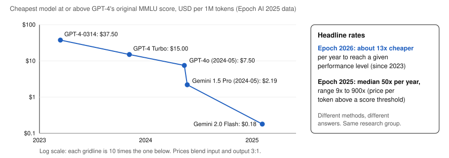

*Figure 10. Data: Epoch AI 2025 table, cheapest model at or above GPT-4's original MMLU score, USD per 1M tokens (3:1 input/output blend). Log scale. Headline rates from Epoch's 2026 and 2025 analyses.*

You can also see the drop on a single vendor's price list. Anthropic's model page lists Claude Opus 4 and Opus 4.1 at $15 input / $75 output per million tokens with a 200K window, and the current Claude Opus 5.5 at $4 / $20 with a 1M window.

**Other terms you'll see** (AA glossary): an **endpoint** is "A hosted instance of a model that can be accessed via an API. A single model may have multiple endpoints across different providers." A **provider** is a company that hosts endpoints. The same open-weights model can be hosted by several providers, each with its own speed and price.

**What this means in practice**

| If you care most about | Watch | Typical move |
|---|---|---|
| Chat feeling quick | Time to first answer token | A smaller model or lower effort for simple turns |
| Long outputs (reports, code) | End-to-end time | A faster endpoint or provider |
| Monthly bill | All tokens in and out, including reasoning, times price | Trim the context, cache repeated input, send easy tasks to cheaper models |
| Fair comparisons | Time and cost per finished task on your workload | OpenAI's advice: "Test representative tasks rather than comparing only the visible response length." |

*Sources: [Artificial Analysis: performance benchmarking methodology](https://artificialanalysis.ai/methodology/performance-benchmarking); [Artificial Analysis: methodology and glossary](https://artificialanalysis.ai/methodology); [OpenAI: Understanding and counting tokens](https://help.openai.com/en/articles/4936856-what-are-tokens-and-how-to-count-them); [Epoch AI 2026, The plunging price of thought](https://epoch.ai/publications/the-plunging-price-of-thought); [Epoch AI 2025, LLM inference price trends](https://epoch.ai/data-insights/llm-inference-price-trends); [Anthropic: Models overview](https://platform.claude.com/docs/en/models/overview).*

## 8. Embeddings and RAG

> **Key idea.** An embedding turns text into a list of numbers so that similar meanings land close together. RAG (Retrieval-Augmented Generation) uses that to find the right documents and paste them into the context before the model answers.

**Embeddings.** You met these in Section 1. Inside the model, each token becomes a vector, and 3Blue1Brown explains that "words with similar meanings tend to land on vectors close to each other." Embedding models apply the same idea to whole sentences or paragraphs. OpenAI's embeddings guide covers using them for search, clustering similar items, and recommendations. In every case you're measuring how close two vectors are.

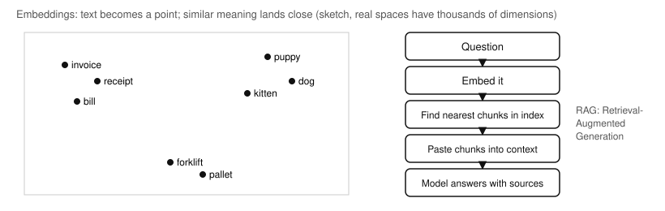

*Figure 11. Left: a two-dimensional sketch (real embeddings have far more dimensions). Right: the basic RAG steps.*

**RAG.** The term comes from Lewis et al., 2020. They describe models "which combine pre-trained parametric and non-parametric memory." Parametric memory is what's stored in the weights (Section 4). Non-parametric memory is an outside index you can search, which in their case was "a dense vector index of Wikipedia." They found RAG models "generate more specific, diverse and factual language" than the same kind of model without retrieval. The original paper also trained the retriever and generator together. Most products today use the looser version in the figure: search an index, then paste what you find into the prompt.

**How a typical setup works:**

1. **Prepare once.** Split your documents into chunks, embed each chunk, and store the vectors in an index (often called a vector database).
2. **On each question,** embed the question and find the closest chunks.
3. **Paste those chunks into the context window** with the question and instructions such as "answer only from these sources and cite them."
4. **The model answers** from text it can actually see, which is Karpathy's "refreshing your working memory."

**Retrieving up front versus "just in time."** Anthropic's context-engineering article notes a shift. Many apps use "embedding-based pre-inference time retrieval," which is the classic RAG above. Agents increasingly add "just in time" retrieval: they keep "lightweight identifiers (file paths, stored queries, web links, etc.)" and "use these references to dynamically load data into context at runtime using tools" (Sections 9 and 10).

**RAG versus fine-tuning, for the same goal**

| | RAG | Fine-tuning |
|---|---|---|
| Changes the weights? | No | Yes |
| Best for | Facts that change, private documents, answers that need sources | A consistent format, tone, or narrow task |
| Updating knowledge | Re-index the documents | Train again |
| Can show where an answer came from? | Yes, it can cite the chunks | Not directly |
| Typical failure | It retrieves the wrong chunk, so the answer is confidently wrong | It forgets or overfits; expensive to redo |

**What this means in practice**

- **Many wrong answers in a RAG system are really retrieval problems.** If the right chunk never made it into the context, the model never had a chance. Check what was retrieved before blaming the model.
- **RAG reduces made-up answers but doesn't remove them** (Section 12), and retrieved text can carry hidden instructions (Section 16).
- **Web search in a chatbot works the same way.** The search results get pasted into the context.

*Sources: [Lewis et al. 2020, Retrieval-Augmented Generation](https://arxiv.org/abs/2005.11401); [OpenAI: Embeddings guide](https://developers.openai.com/api/docs/guides/embeddings); [Anthropic: Effective context engineering for AI agents](https://www.anthropic.com/research/effective-context-engineering-for-ai-agents); [3Blue1Brown](https://www.3blue1brown.com/lessons/gpt/); [Karpathy: Deep Dive](https://www.youtube.com/watch?v=7xTGNNLPyMI).*
## 9. Prompting and context engineering

> **Key idea.** Prompting is writing good instructions. Context engineering is the bigger job of deciding everything that goes into the context window on each turn: instructions, tool definitions, examples, retrieved documents, and history. The goal is the smallest set of tokens that gets the result you want.

**Prompt engineering.** OpenAI defines it as "the process of writing effective instructions for a model, such that it consistently generates content that meets your requirements." Two practical points from its guide: instructions carry different levels of authority (an app developer's instructions are "prioritized ahead of `user` messages"), and "different model types (like reasoning versus GPT models) might need to be prompted differently." Anthropic's overview starts one step earlier. Before tuning a prompt you should have "A clear definition of the success criteria for your use case" and "Some ways to empirically test against those criteria." It also notes that some problems aren't prompt problems at all: "you can sometimes improve latency and cost more easily by choosing a different model."

**Context engineering.** Anthropic's Sept 2025 article describes the shift: building with models "is becoming less about finding the right words and phrases for your prompts, and more about answering the broader question of 'what configuration of context is most likely to generate our model's desired behavior?'" It defines context engineering as "the set of strategies for curating and maintaining the optimal set of tokens (information) during LLM inference." The reason it matters is context rot (Section 3): models have an "attention budget," and "Every new token introduced depletes this budget." The guiding rule: "finding the smallest possible set of high-signal tokens that maximize the likelihood of some desired outcome."

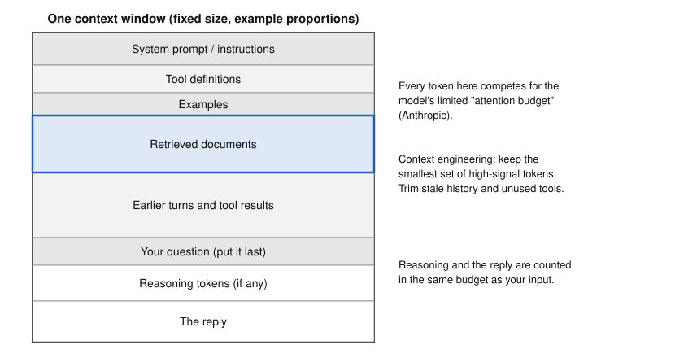

*Figure 12. Example proportions, not measured. Everything competes for one fixed budget, including the reply and any reasoning.*

**What goes in, and how to handle each part** (from Anthropic's article unless noted):

| Part of the context | Advice |
|---|---|
| System prompt (instructions) | Use "simple, direct language" at "the right altitude": not "complex, brittle logic," and not "vague, high-level guidance." Organize it into sections with XML tags or Markdown headers. Aim for "the minimal set of information that fully outlines your expected behavior," noting that "minimal does not necessarily mean short." |
| Tool definitions | Tools should be "self-contained, robust to error, and extremely clear with respect to their intended use." A common failure is "bloated tool sets": "If a human engineer can't definitively say which tool should be used in a given situation, an AI agent can't be expected to do better." |
| Examples | Few-shot examples are "a well known best practice." Use "a set of diverse, canonical examples," not "a laundry list of edge cases." "For an LLM, examples are the 'pictures' worth a thousand words." |
| Retrieved documents | Retrieve up front (classic RAG, Section 8), or let the agent load things "just in time" with tools. A hybrid is common. For long documents, Anthropic's hallucination guide suggests having the model "extract word-for-word quotes first" (Section 12). |
| Conversation history | Trim it. Old tool results are "low-hanging superfluous content"; once a tool result is deep in the history, "why would the agent need to see the raw result again?" |
| Your question | Google's long-context FAQ: put "your query / question at the end of the prompt (after all the other context)." |

**Three ways to work past the window on long tasks:**

#### Compaction
Summarize the conversation as it nears the limit and start fresh with the summary. Anthropic: "Compaction maintains conversational flow for tasks requiring extensive back-and-forth." The risk is that "overly aggressive compaction can result in the loss of subtle but critical context."
#### Structured notes
The agent "regularly writes notes persisted to memory outside of the context window" and reads them back later, like a to-do list or a NOTES.md file. "Note-taking excels for iterative development with clear milestones."
#### Sub-agents
Helper agents work in their own clean context windows and return "a condensed, distilled summary of its work (often 1,000-2,000 tokens)." Best for "complex research and analysis where parallel exploration pays dividends."

**What this means in practice**

- **Decide what "good" looks like and test it** before spending hours on wording.
- **Fewer, better tokens beat more tokens.** Cut stale history, unused tools, and documents that aren't relevant to this turn.
- **Show, don't list.** A few good examples teach more than a page of rules.
- Anthropic's summary advice for teams building agents: "do the simplest thing that works."

*Sources: [OpenAI: Prompt engineering](https://developers.openai.com/api/docs/guides/prompt-engineering); [Anthropic: Prompt engineering overview](https://platform.claude.com/docs/en/build-with-claude/prompt-engineering/overview); [Anthropic: Effective context engineering for AI agents](https://www.anthropic.com/research/effective-context-engineering-for-ai-agents); [Anthropic: Reduce hallucinations](https://platform.claude.com/docs/en/test-and-evaluate/strengthen-guardrails/reduce-hallucinations); [Google: Long context](https://aistudio.google.com/docs/long-context).*

## 10. Connecting models to tools: function calling and MCP

> **Key idea.** A model can't act on its own. With function calling, it writes a structured request ("call this function with these inputs"), your software runs it, and the result goes back into the context. MCP (Model Context Protocol) is an open standard so that one tool integration can plug into many AI apps.

**Function calling (also called tool use).** Anthropic: "Tool use (also called function calling) lets Claude call functions that you define or that Anthropic provides. Claude determines when to call a tool based on the user's request and the tool's description." OpenAI: "A function is a specific kind of tool, defined by a JSON schema," which is a precise description of the inputs it takes. The model never runs anything itself. OpenAI lays out the loop in five steps:

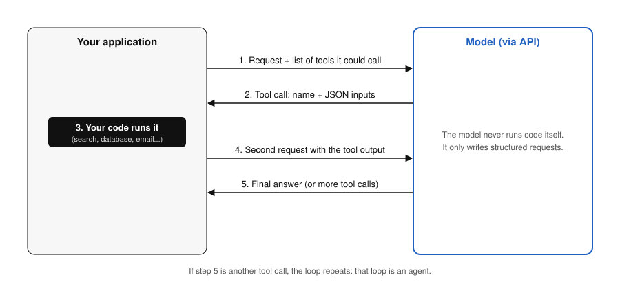

*Figure 13. OpenAI's five-step tool calling flow, drawn for this guide.*

1. "Make a request to the model with tools it could call"
2. "Receive a tool call from the model"
3. "Execute code on the application side with input from the tool call"
4. "Make a second request to the model with the tool output"
5. "Receive a final response from the model (or more tool calls)"

Step 5 is where agents come from: if the model asks for another tool, the loop continues (Section 11).

**Where the tool runs.** Anthropic splits tools by location. "Client tools" (your own functions) "run in your application": the model returns a structured call, "Your code runs the operation and sends back a tool_result." "Server tools (such as web_search, web_fetch, code_execution, and tool_search) run on Anthropic's infrastructure," so you get results without running anything. OpenAI likewise offers built-in tools that "search the web, run code, access the functionality of an MCP server, and more."

**MCP: one plug for many apps.** Without a standard, every AI app needs its own custom integration for every tool. MCP's introduction: "MCP (Model Context Protocol) is an open-source standard for connecting AI applications to external systems." Its analogy: "Think of MCP like a USB-C port for AI applications. Just as USB-C provides a standardized way to connect electronic devices, MCP provides a standardized way to connect AI applications to external systems." The site says it is supported by "AI assistants like Claude and ChatGPT, development tools like Visual Studio Code, Cursor," and others. The current specification is revision 2026-07-28.

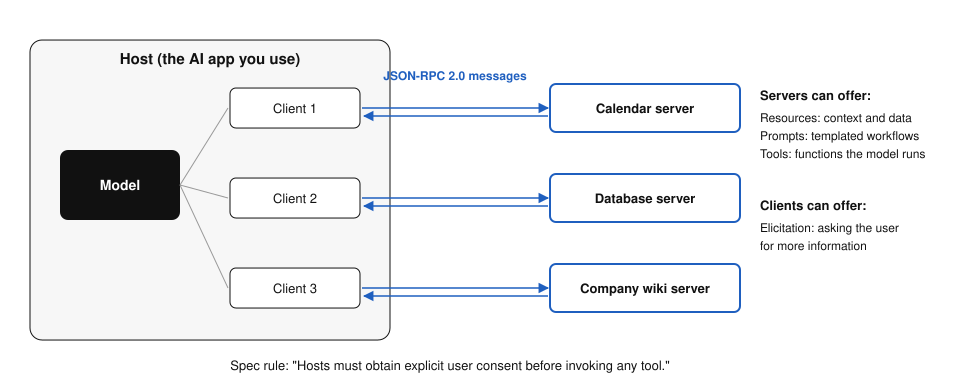

*Figure 14. The three roles in the MCP specification (revision 2026-07-28).*

**The parts, per the specification.** "The protocol uses JSON-RPC 2.0 messages," a simple standard message format, between three roles:

- **Hosts:** "LLM applications that initiate connections" (the chat app or coding tool you use).
- **Clients:** "Connectors within the host application," one per server.
- **Servers:** "Services that provide context and capabilities" (a calendar, a database, a company wiki).

Servers can offer three kinds of things: **Resources**, "Context and data, for the user or the AI model to use"; **Prompts**, "Templated messages and workflows for users"; and **Tools**, "Functions for the AI model to execute." Clients can offer **Elicitation**, "Server-initiated requests for additional information from users." Optional extensions add things like long-running **Tasks** and **MCP Apps**, "Interactive UI elements (charts, forms, video players) rendered inline within conversations." The spec says MCP "takes some inspiration from the Language Server Protocol," the standard that lets code editors support many programming languages.

**Safety is written into the spec.** "Tools represent arbitrary code execution and must be treated with appropriate caution." "Hosts must obtain explicit user consent before invoking any tool." "Hosts must not transmit resource data elsewhere without user consent." And descriptions of what a tool does "should be considered untrusted, unless obtained from a trusted server." Section 16 explains why.

| | Function calling | MCP |
|---|---|---|
| What it is | A feature of one vendor's API | An open protocol across apps and vendors |
| Who defines the tool | Your app, per request | A server, reusable by any MCP host |
| Good for | Tools specific to one app | Sharing one integration across many AI apps |
| Relationship | The model-side mechanism | Commonly delivers tools that the model then calls via function calling |

**What this means in practice**

- **"Connectors" and "integrations" in AI apps are often MCP servers.** Adding one gives the model new data and new actions.
- **Each tool you add is a new power and a new risk.** Grant only what the task needs (Section 16).
- **Tool definitions use context too** (Section 9). Dozens of connected tools cost tokens on every turn.

*Sources: [OpenAI: Function calling](https://developers.openai.com/api/docs/guides/function-calling); [Anthropic: Tool use overview](https://platform.claude.com/docs/en/agents-and-tools/tool-use/overview); [Model Context Protocol: Introduction](https://modelcontextprotocol.io/docs/getting-started/intro); [Model Context Protocol: Specification](https://modelcontextprotocol.io/specification/latest).*

## 11. Model vs harness, and agents with tool use

> **Key idea.** The model is the trained network that predicts tokens. The harness is all the software around it: system prompt, tools, memory, context management, and the loop that lets it act and see results. The same model feels very different in different harnesses.

**Where the word comes from.** Anthropic's engineering writing uses "harness" this way. Its November 2025 article calls the Claude Agent SDK "a powerful, general-purpose agent harness." The article describes harness design choices, not changes to the model: an "initializer" agent that sets up the work, a coding agent that makes steady progress in later sessions, and a progress file the agent reads at the start of each session, because "compaction isn't sufficient." You'll also hear "scaffold," "agent framework," or "wrapper" for the same idea.

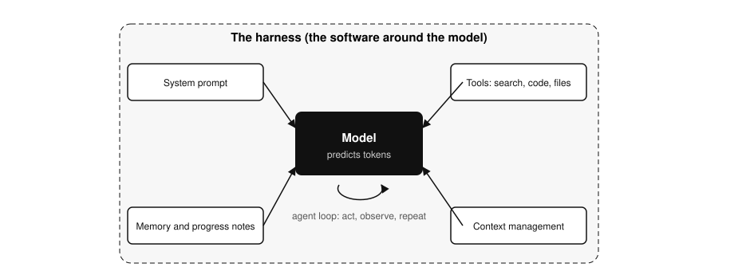

*Figure 15. The same model behaves very differently depending on the harness around it.*

**Why the difference matters.** Two products can run the *same* model and feel completely different, because one has web search, a code runner, file access, and good context management, and the other doesn't. Swapping in a stronger model won't fix a weak harness. When someone says "the AI is better now," ask whether the model changed, the harness changed, or both. The harness even changes benchmark scores: Artificial Analysis notes, for example, that it runs Terminal-Bench 4.0 with a specific "mini-swe-agent harness" (Section 14).

**Tool use.** The model writes a structured request and the harness carries it out (Section 10). Karpathy's advice for users, from the Deep Dive: "lean on tools and tool use instead of allowing the models to do all of the stuff in their memory." He uses this for math, counting, and recent facts.

**Workflows versus agents.** Anthropic draws a clear line:

- **Workflows** are "systems where LLMs and tools are orchestrated through predefined code paths." The steps are fixed in advance.
- **Agents** are "systems where LLMs dynamically direct their own processes and tool usage, maintaining control over how they accomplish tasks."

The basic building block for both is "an LLM enhanced with augmentations such as retrieval, tools, and memory." Anthropic's advice is to find "the simplest solution possible, and only increasing complexity when needed." Its later context-engineering article boils agents down further: "LLMs autonomously using tools in a loop." Many products call any workflow an "agent," so check which kind you're actually getting.

| | Workflow | Agent |
|---|---|---|
| Who decides the next step | The code, written ahead of time | The model, as it goes |
| Predictability | High | Lower |
| Good for | Repeatable processes with known steps | Open-ended tasks where the path isn't known in advance |
| Main risk | Rigid when something unexpected happens | Wanders off, loops, or takes costly actions |

**What this means in practice**

- **When you evaluate an AI product, evaluate the harness as well as the model.** What tools can it use? How does it handle long tasks? What is it allowed to do without asking?
- **Agents spend more tokens and take more time,** because each loop re-reads a growing context (Sections 3 and 7).
- **Permissions belong to the harness.** Whether an agent can send email or delete files is a harness setting, not something the model decides (Section 16).

*Sources: [Anthropic: Effective harnesses for long-running agents](https://www.anthropic.com/research/effective-harnesses-for-long-running-agents); [Anthropic: Building effective agents](https://www.anthropic.com/research/building-effective-agents); [Anthropic: Effective context engineering for AI agents](https://www.anthropic.com/research/effective-context-engineering-for-ai-agents); [Artificial Analysis: Intelligence Benchmarking](https://artificialanalysis.ai/methodology/intelligence-benchmarking); [Karpathy: Deep Dive](https://www.youtube.com/watch?v=7xTGNNLPyMI); [Karpathy: How I use LLMs](https://www.youtube.com/watch?v=EWvNQjAaOHw).*

## 12. Hallucinations: why models make things up

> **Key idea.** A hallucination is a fluent, confident statement that is false. Models do it partly because most tests score a guess higher than "I don't know." It can be reduced, mainly by letting the model abstain and by grounding answers in sources you provide.

**What it is.** OpenAI: "Hallucinations are plausible but false statements generated by language models." Its example: asked for the title of one of the paper's authors' PhD dissertation, a widely used chatbot "confidently produced three different answers," and none was correct. Anthropic's docs describe text that is "factually incorrect or inconsistent with the given context."

**Why it starts: arbitrary facts can't be learned from patterns.** Kalai et al.'s 2025 paper *Why Language Models Hallucinate* argues that "Hallucinations need not be mysterious -- they originate simply as errors in binary classification. If incorrect statements cannot be distinguished from facts, then hallucinations in pretrained language models will arise through natural statistical pressures." OpenAI's write-up gives the intuition. Spelling and matching parentheses follow consistent patterns, so models stop making those errors as they grow. "But arbitrary low-frequency facts, like a pet's birthday, cannot be predicted from patterns alone and hence lead to hallucinations." This connects to Karpathy's lossy-zip picture from Section 1.

**Why it persists: tests reward guessing.** The paper's main claim: "language models hallucinate because the training and evaluation procedures reward guessing over acknowledging uncertainty." Think of a multiple-choice exam. OpenAI: if a model is asked for someone's birthday and guesses "September 10," "it has a 1-in-365 chance of being right. Saying 'I don't know' guarantees zero points. Over thousands of test questions, the guessing model ends up looking better on scoreboards than a careful model that admits uncertainty."

**One concrete comparison.** OpenAI's post reprints SimpleQA results from the GPT-5 system card for two specific OpenAI models. This is one benchmark and two models, not a general rule:

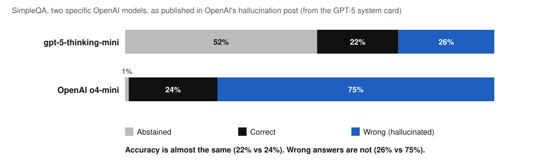

*Figure 16. Data: SimpleQA results for gpt-5-thinking-mini and OpenAI o4-mini, as published in OpenAI's "Why language models hallucinate" (from the GPT-5 system card).*

| SimpleQA | gpt-5-thinking-mini | OpenAI o4-mini |
|---|---|---|
| Abstention rate (no specific answer given) | 52% | 1% |
| Accuracy rate (right answer) | 22% | 24% |
| Error rate (wrong answer) | 26% | 75% |

OpenAI's reading: "In terms of accuracy, the older OpenAI o4-mini model performs slightly better. However, its error rate (i.e., rate of hallucination) is significantly higher." An accuracy-only leaderboard would rank o4-mini higher.

**The proposed fix: change the scoring.** "Penalize confident errors more than you penalize uncertainty, and give partial credit for appropriate expressions of uncertainty." The paper argues this must happen in the main benchmarks, "rather than introducing additional hallucination evaluations." Some scorekeepers have started. Artificial Analysis's Intelligence Index now includes a "Non-Hallucination Rate - calculated as 1 minus the hallucination rate," worth 5% of the index (Section 13).

**Myths the paper pushes back on** (from OpenAI's summary):

- "Hallucinations will be eliminated by improving accuracy." No: "Accuracy will never reach 100% because... some real-world questions are inherently unanswerable."
- "Hallucinations are inevitable." No: "They are not, because language models can abstain when uncertain."
- Only big models can avoid them. No: "It can be easier for a small model to know its limits."

**How to reduce them in your own use** (Anthropic's "Reduce hallucinations" guide):

#### Allow "I don't know"
"Explicitly give Claude permission to admit uncertainty. This technique can drastically reduce false information."
#### Quote first, then answer
"For tasks involving long documents (>20k tokens), ask Claude to extract word-for-word quotes first before performing its task."
#### Make it cite, and retract
Have it "cite quotes and sources for each of its claims," then check each claim: "If it can't find a quote, it must retract the claim."
#### Restrict and compare
"Explicitly instruct Claude to only use information from provided documents." Run the same prompt several times: "Inconsistencies across outputs could indicate hallucinations."

**What this means in practice**

- **Be most careful with specific, rare facts:** names, dates, citations, numbers, quotes. These are exactly the "arbitrary low-frequency facts" the paper describes.
- **Give the model the source** (Section 8) and ask it to quote from it.
- **Prefer a model that sometimes says "I don't know."** A lower accuracy score can come with far fewer wrong answers, as the SimpleQA table shows.

*Sources: [Kalai et al. 2025, Why Language Models Hallucinate](https://arxiv.org/abs/2509.04664); [OpenAI: Why language models hallucinate](https://openai.com/index/why-language-models-hallucinate/); [Anthropic: Reduce hallucinations](https://platform.claude.com/docs/en/test-and-evaluate/strengthen-guardrails/reduce-hallucinations); [Artificial Analysis: Intelligence Benchmarking](https://artificialanalysis.ai/methodology/intelligence-benchmarking).*
## 13. Benchmarks: what scores mean and where they mislead

> **Key idea.** A benchmark is a standard way to score models so they can be compared. Every benchmark measures something narrower than "how good is this model," and the popular ones change often. Use public scores to make a shortlist and your own tests to decide.

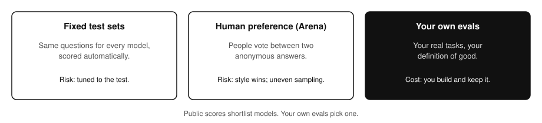

*Figure 17. Three ways to evaluate. Each one answers a different question.*

**1. Fixed test sets and combined indexes.** Every model gets the same questions and is scored automatically. Stanford's HELM (Holistic Evaluation of Language Models) describes itself as "a living benchmark for transparency in language models," taking the broad, "holistic" approach its name says. Artificial Analysis combines several evaluations into one Intelligence Index. These scores are useful for narrowing a list, but a test only covers the skills it actually asks about.

**The Artificial Analysis Intelligence Index, as of November 2026.** It's worth knowing what's inside, because the mix changes every few months. Version 5.0.1 "incorporates 9 evaluations," grouped into four categories weighted 25% each:

| Category (25% each) | Evaluations in v5.0.1 | Weight |
|---|---|---|
| Knowledge Work | AA-Briefcase v1.1 (agentic tasks with file outputs) | 15% |
| | AutomationBench-AA (workflow automation with API tools) | 5% |
| | GDP.pdf (answers grounded in a long PDF) | 5% |
| Coding | FrontierCode-AA 2.0 (code changes to open-source repositories) | 15% |
| | Terminal-Bench 4.0 (terminal tasks) | 10% |
| Science | Terminal-Bench-Science 0.1 | 15% |
| | CritPt v2 (Hard Subset), physics | 10% |
| General | AA-Omniscience v1.1: accuracy 10%, non-hallucination 5% | 15% |
| | HLE-Diamond (1,000 questions from the Humanity's Last Exam family) | 10% |

**What changed recently** (from the index's version history): v4.0 (January 2026) removed MMLU-Pro, LiveCodeBench, and AIME 2025. v4.2 (September 2026) removed GPQA Diamond. v5.0 (October 2026) removed Humanity's Last Exam (adding HLE-Diamond instead), SciCode, AA-LCR, and GDPval-AA, and rebalanced to four equal categories. The direction is clear: away from multiple-choice knowledge tests, toward agent tasks, and with an explicit penalty for hallucination (Section 12). A score from last spring isn't comparable to one from today, even on the "same" index.

**2. Human preference: Arena.** People ask a question, see two anonymous answers, and vote for the better one. The Chatbot Arena paper describes "a pairwise comparison approach" using crowdsourced votes ("over 240K votes" when it was written). Votes are turned into a ranking. The leaderboard's old address, lmarena.ai, now forwards to **arena.ai**. The upside is that it captures what real people prefer on real questions. The downside is that preference can reward style.

**3. LLMs judging LLMs.** The MT-Bench paper found that strong models like GPT-4, used as judges, reach "over 80% agreement" with human preferences, "the same level of agreement between humans." It also lists known biases: **position** (favoring the first answer), **verbosity** (favoring longer answers), and **self-enhancement** (favoring answers like its own). Many current benchmarks, including several in the AA index, use model judges for grading.

**How leaderboards get gamed.** *The Leaderboard Illusion* (2025) studied Chatbot Arena and found that "undisclosed private testing practices benefit a handful of providers who are able to test multiple variants before public release and retract scores if desired." At the extreme, it found "27 private LLM variants tested by Meta in the lead-up to the Llama-4 release." It also found uneven access to data: Google and OpenAI received an estimated 19.2% and 20.4% of all Arena data, while 83 open-weight models together received about 29.7%. Even limited extra Arena data produced "relative performance gains of up to 112%" on Arena-style questions. The authors conclude these patterns lead to "overfitting to Arena-specific dynamics rather than general model quality."

**What this means in practice**

- **Use public scores to make a shortlist, and your own tests to decide.** Run the two or three top candidates on 20 to 50 real examples from your actual work, and decide what "good" means before you look at the results.
- **Read the fine print on any headline score:** which benchmark and version, which model version, which settings and effort level, and which harness.
- **Be wary of a single number.** Look at several kinds of evaluation together.

*Sources: [Artificial Analysis: Intelligence Benchmarking](https://artificialanalysis.ai/methodology/intelligence-benchmarking); [Stanford HELM](https://crfm.stanford.edu/helm/); [Chiang et al. 2024, Chatbot Arena](https://arxiv.org/abs/2403.04132); [Arena leaderboard](https://arena.ai/); [Zheng et al. 2023, Judging LLM-as-a-Judge with MT-Bench and Chatbot Arena](https://arxiv.org/abs/2306.05685); [Singh et al. 2025, The Leaderboard Illusion](https://arxiv.org/abs/2504.20879).*

## 14. Named benchmarks, and test leakage

> **Key idea.** Each benchmark name stands for a specific test with a specific format. Most get "solved" within a few years, and their questions can leak into training data, which inflates scores. Always ask which test, which version, and whether it could have been seen in training.

These five names come up constantly. The numbers below are from each benchmark's own paper or site, at the time it was published. They show how hard the test was then, not who leads now.

#### MMLU (2020)
A multiple-choice test that "covers 57 tasks including elementary mathematics, US history, computer science, law, and more." At launch, "the very largest GPT-3 model improves over random chance by almost 20 percentage points on average." By 2025 the Humanity's Last Exam authors wrote that "LLMs now achieve over 90% accuracy on popular benchmarks like MMLU." Saturated: it no longer separates top models.
#### GPQA (2023)
"448 multiple-choice questions written by domain experts in biology, physics, and chemistry." PhD-level experts "reach 65% accuracy," while skilled non-experts "only reach 34% accuracy, despite spending on average over 30 minutes with unrestricted access to the web," hence "Google-proof." The best GPT-4 baseline scored 39%. Artificial Analysis dropped GPQA Diamond from its index in September 2026.
#### SWE-bench (2023)
"2,294 software engineering problems drawn from real GitHub issues and corresponding pull requests across 12 popular Python repositories." The model gets a codebase and an issue and must edit the code to fix it. At launch, "The best-performing model, Claude 2, is able to solve a mere 1.96% of the issues."
#### Humanity's Last Exam (2025)
Built because older tests were saturated. "HLE consists of 2,500 questions," multiple-choice and short-answer, written by "nearly 1,000 subject expert contributors affiliated with over 500 institutions across 50 countries." Each question "cannot be quickly answered via internet retrieval." The organizers keep "a private test set of held out questions."
#### Terminal-Bench (2026)
Agents must complete tasks in a computer terminal. The paper describes "Terminal-Bench 2.0," "89 tasks in computer terminal environments inspired by problems from real workflows," each with "a unique environment, human-written solution, and comprehensive tests." At publication, frontier agents scored "less than 65%."

**Version numbers matter.** Sources describe different versions of the same benchmark. The Terminal-Bench paper describes version 2.0 with 89 tasks. Artificial Analysis's index uses Terminal-Bench 4.0 with 66 tasks. The project's own site now headlines Terminal-Bench 4.1. A score is only meaningful with its version. Even HLE's subject count differs by source: the paper says "dozens of subjects" and the site says "over a hundred subjects." Both agree on 2,500 questions.

**Test leakage (contamination).** Models train on huge scrapes of the internet, and benchmark questions are on the internet. Sainz et al. (2023): "The worst kind of data contamination happens when a Large Language Model (LLM) is trained on the test split of a benchmark, and then evaluated in the same benchmark." The effect: "Contamination causes an overestimation of the performance of a contaminated model." They add that "The extent of the problem is unknown, as it is not straightforward to measure."

Yang et al. (2023) showed why it's hard to catch. Most cleanup uses exact text matching, but "simple variations of test data (e.g., paraphrasing, translation) can easily bypass these decontamination measures." In their experiment, if rephrased test data isn't removed, "a 13B model can easily overfit a test benchmark and achieve drastically high performance, on par with GPT-4." Using a stronger detection method, they checked real training datasets. Their finding, in their words: "in pre-training sets such as RedPajama-Data-1T and StarCoder-Data, we identified that 8-18% of the HumanEval benchmark overlaps." HumanEval is a coding benchmark. That 8 to 18% is the overlap they found **in those two public pretraining datasets**. It is not a measured rate for any particular model or for models in general.

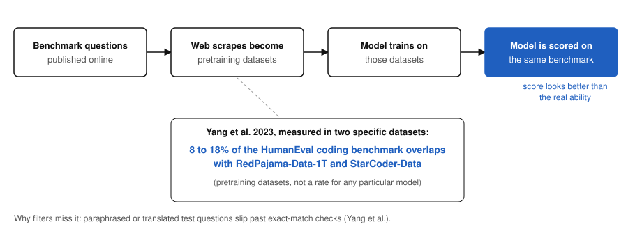

*Figure 18. How leakage happens, with Yang et al.'s finding for two specific pretraining datasets. The flow is a sketch; the 8 to 18% is from the paper.*

**Defenses** visible in the sources: keep questions private (HLE's held-out set, and several AA evaluations), write fresh tests (Yang et al. "call for the community to actively develop fresh one-time exams"), and use stronger detection. Epoch AI raises a related problem in its 2025 price analysis: developers "may accidentally train models on benchmark data, or use knowledge about the benchmark to inform training (which seems to have become more common since 2024)." Its 2026 report calls deliberate tuning for benchmarks "benchmaxxing."

**What this means in practice**

- **Old, famous benchmarks are the most likely to be saturated or leaked.** Give newer, private, or held-out tests more weight.
- **A huge jump on one public benchmark, with no matching improvement elsewhere, is a warning sign.**
- **Your own private examples (Section 13) can't have leaked,** which is one more reason to test on them.

*Sources: [Hendrycks et al. 2020, MMLU](https://arxiv.org/abs/2009.03300); [Rein et al. 2023, GPQA](https://arxiv.org/abs/2311.12022); [Jimenez et al. 2023, SWE-bench](https://arxiv.org/abs/2310.06770); [Phan et al. 2025, Humanity's Last Exam](https://arxiv.org/abs/2501.14249); [Humanity's Last Exam site](https://lastexam.ai/); [Merrill et al. 2026, Terminal-Bench](https://arxiv.org/abs/2601.11868); [Terminal-Bench site](https://www.tbench.ai/); [Yang et al. 2023, Rethinking Benchmark and Contamination](https://arxiv.org/abs/2311.04850); [Sainz et al. 2023, NLP Evaluation in trouble](https://arxiv.org/abs/2310.18018); [Artificial Analysis: Intelligence Benchmarking](https://artificialanalysis.ai/methodology/intelligence-benchmarking); [Epoch AI 2025](https://epoch.ai/data-insights/llm-inference-price-trends); [Epoch AI 2026](https://epoch.ai/publications/the-plunging-price-of-thought).*

## 15. Beyond text: images, audio, and video

> **Key idea.** Modern models take images, audio, and video as well as text. The trick is the same as for text: cut the input into pieces, turn each piece into tokens, and feed them in. Images are billed in tokens, and bigger images cost more.

**How models learned to connect pictures and words.** A key step was OpenAI's CLIP (2021). Older vision systems were "trained to predict a fixed set of predetermined object categories," so they couldn't recognize anything outside their list. CLIP instead learned from "predicting which caption goes with which image," trained on "400 million (image, text) pairs collected from the internet." Because it learned images and text together, "natural language is used to reference learned visual concepts (or describe new ones) enabling zero-shot transfer," meaning it can handle categories it was never explicitly trained on. Its headline result: it matched "the accuracy of the original ResNet-50 on ImageNet zero-shot without needing to use any of the 1.28 million training examples it was trained on."

**Images become tokens.** Anthropic's vision docs describe how Claude reads an image: "Claude processes images in patches instead of pixels. Each patch is a 28×28-pixel block of the image, referred to as a visual token. An image, therefore, costs ⌈width / 28⌉ × ⌈height / 28⌉ visual tokens." (The brackets mean "round up.") OpenAI does something similar with a different size: "Some models tokenize images by covering them with 32px x 32px patches," and "images count as tokens and will be billed accordingly." Like text tokenizers (Section 2), each vendor slices differently.

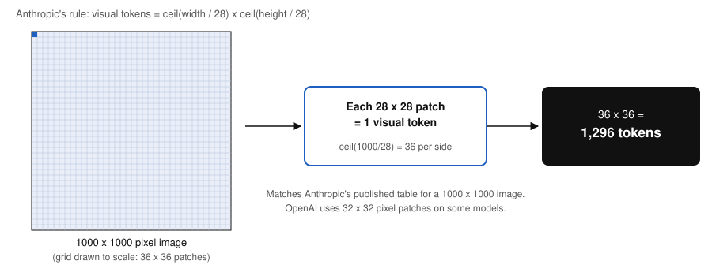

*Figure 19. A 1000 by 1000 pixel image under Anthropic's rule: 36 by 36 patches of 28 by 28 pixels = 1,296 visual tokens, matching Anthropic's published table.*

**Real token costs for images** (Anthropic's published table):

| Image size | Standard tier tokens | High-resolution tier tokens |
|---|---|---|
| 200 x 200 px | 64 | 64 |
| 1000 x 1000 px | 1,296 | 1,296 |
| 1920 x 1080 px | 1,560 (downsized to 1456 x 819) | 2,691 |
| 3840 x 2160 px (4K) | 1,560 (downsized) | 4,784 (downsized to 2576 x 1449) |

High resolution is automatic on "Claude 4.7 and later models," with a long edge up to 2,576 pixels and up to 4,784 visual tokens. Anthropic's cost example: at Claude Opus 5.5's $4 per million input tokens on the high-resolution tier, a 1000 by 1000 image "costs about $5.18 USD per thousand." OpenAI uses detail settings instead (`low`, `high`, `original`, `auto`), where "`low` fits within 512 × 512 pixels."

**Audio and video.** Google's current Gemini 4 models list their inputs as "Text, Image, Audio, Video, PDF," and Google offers separate low-latency voice models (Gemini 3.8 Live) and text-to-speech models. Anthropic says all its current models "support text and image input, text output." OpenAI says its latest models "support text and image input, text output." How audio and video are turned into tokens internally isn't covered by the sources in this guide.

**Known limits** (Anthropic's list): models "might hallucinate or make mistakes when interpreting low-quality, rotated, or very small images under 200 pixels"; counts are "approximate"; coordinates are "approximate"; and "Claude cannot determine whether an image is AI-generated." Claude also "cannot be used to name people in images."

**What this means in practice**

- **Resize before you send.** Anthropic: "If you don't need the additional fidelity... downsample images before sending to control token costs."
- **Make text in images legible.** Heavy compression "can make text difficult to read."
- **Don't trust image-based counting, measuring, or fake detection** without checking.

*Sources: [Radford et al. 2021, CLIP](https://arxiv.org/abs/2103.00020); [Anthropic: Vision](https://platform.claude.com/docs/en/build-with-claude/vision); [OpenAI: Images and vision](https://developers.openai.com/api/docs/guides/images-vision); [Google: Gemini models](https://aistudio.google.com/docs/models); [Anthropic: Models overview](https://platform.claude.com/docs/en/models/overview); [OpenAI: Models](https://developers.openai.com/api/docs/models).*

## 16. Safety and security basics: prompt injection and agent permissions

> **Key idea.** A model treats every piece of text in its context as possible instructions, including web pages, emails, and tool results. Prompt injection is when hostile text hijacks it. It's the top risk on OWASP's list, there's no complete fix, and the main defense is limiting what the model is allowed to do.

**What prompt injection is.** OWASP, the security community that publishes the standard Top 10 risk lists, defines it: "A Prompt Injection Vulnerability occurs when user prompts alter the LLM's behavior or output in unintended ways." Crucially, injections "do not need to be human-visible/readable, as long as the content is parsed by the model." OpenAI's agent safety guide: "A prompt injection happens when untrusted text or data enters an AI system, and malicious contents in that text or data attempt to override instructions to the AI." The goals "can include exfiltrating private data via downstream tool calls, taking misaligned actions, or otherwise changing model behavior."

**Direct and indirect.** In a direct injection, the person typing is the attacker. In an indirect one, the user is innocent but the model reads hostile content. OWASP: "Indirect prompt injections occur when an LLM accepts input from external sources, such as websites or files." Anthropic describes the indirect case as when "the user is trusted but Claude processes third-party content (webpages, emails, documents, tool results) that contains adversarial instructions." OWASP's example: "A user employs an LLM to summarize a webpage containing hidden instructions that cause the LLM to insert an image linking to a URL, leading to exfiltration of the the private conversation." **Jailbreaking** is related: OWASP calls it "a form of prompt injection where the attacker provides inputs that cause the model to disregard its safety protocols entirely."

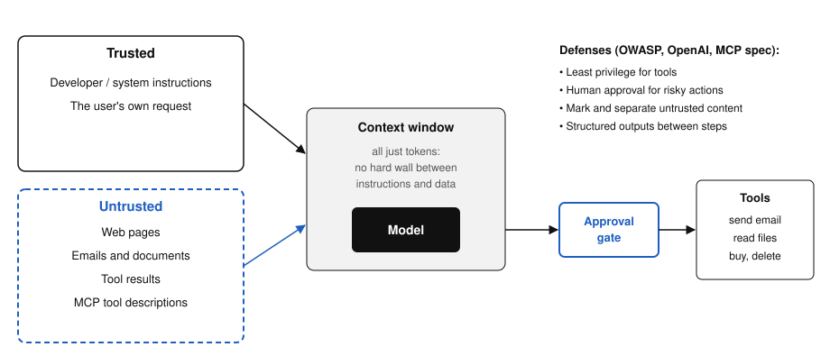

*Figure 20. Trusted instructions and untrusted content end up in the same context window. Defenses sit at the boundary and at the tools.*

**Why it's hard to fix.** Everything in the context window is just tokens to the model (Sections 2 and 9). There's no hard wall between "instructions" and "data." OWASP notes that RAG and fine-tuning "do not fully mitigate prompt injection vulnerabilities." OpenAI: "even with these mitigations, agents won't be perfect and can still make mistakes or be tricked." Data can also leak with no attacker at all. OpenAI: "a model may send more data to an MCP than the user expected or intended."

**OWASP Top 10 for LLM Applications (2025 edition, still current on the OWASP site):**

| # | Risk |
|---|---|
| LLM01 | Prompt Injection |
| LLM02 | Sensitive Information Disclosure |
| LLM03 | Supply Chain |
| LLM04 | Data and Model Poisoning |
| LLM05 | Improper Output Handling |
| LLM06 | Excessive Agency |
| LLM07 | System Prompt Leakage |
| LLM08 | Vector and Embedding Weaknesses |
| LLM09 | Misinformation |
| LLM10 | Unbounded Consumption |

**Defenses** (OWASP's prevention list, with OpenAI and the MCP spec):

#### Least privilege
OWASP: "Restrict the model's access privileges to the minimum necessary for its intended operations." Keep credentials in code, "rather than providing them to the model."
#### Human approval
OWASP: "Implement human-in-the-loop controls for privileged operations." OpenAI: "always enable tool approvals so end users can review and confirm every operation, including reads and writes." MCP: "Hosts must obtain explicit user consent before invoking any tool."
#### Separate untrusted content
OWASP: "Separate and clearly denote untrusted content to limit its influence." OpenAI: "Pass untrusted inputs through user messages," never into the developer's instructions.
#### Constrain outputs and test
OpenAI: use structured outputs ("enums, fixed schemas, required field names") to "eliminate freeform channels that attackers can exploit." OWASP: regular attack simulations, "treating the model as an untrusted user."

**What this means in practice**

- **The more an agent can do, the more an injection can do.** An assistant that can read your email and also send email is a much bigger target than one that can only read (OWASP's "Excessive Agency").
- **Treat anything the model read from outside as untrusted,** including its summary of a web page.
- **Keep approvals on for actions that send, buy, delete, or share.**

*Sources: [OWASP: LLM01:2025 Prompt Injection](https://genai.owasp.org/llmrisk/llm01-prompt-injection/); [OWASP Top 10 for LLM Applications](https://genai.owasp.org/llm-top-10/); [OpenAI: Safety in building agents](https://developers.openai.com/api/docs/guides/agent-builder-safety); [Anthropic: Mitigate jailbreaks and prompt injections](https://platform.claude.com/docs/en/test-and-evaluate/strengthen-guardrails/mitigate-jailbreaks); [Model Context Protocol: Specification](https://modelcontextprotocol.io/specification/latest).*
## 17. Where the model runs: hosted API, enterprise cloud, or on-prem

> **Key idea.** The same kind of model can run on the vendor's servers, inside your company's cloud account, or on hardware you own. Each option trades control for convenience. The deciding question is usually where your data is allowed to go.

**The three options**

- **A vendor's hosted API or app.** You send prompts to the model company and get answers back. It's the fastest way to start and gives you the newest closed models. Your data goes to the vendor under their terms.
- **An enterprise cloud deal.** You use models through a big cloud platform under your company's existing cloud contract and security controls. Amazon Bedrock is one example. Its data-protection page says "The AWS shared responsibility model applies to data protection in Amazon Bedrock," and that after a model provider delivers a model, Bedrock "will perform a deep copy of a model provider's inference and training software" into deployment accounts AWS runs. "Model providers don't have any access to those accounts," so "they don't have access to Amazon Bedrock logs or to customer prompts and completions." In other words, the model runs inside the cloud provider's environment, not the model company's. Vendor model pages list these cloud IDs side by side: Anthropic's, for instance, gives each current model an Amazon Bedrock ID and a Google Cloud ID.
- **On-prem or self-hosted.** You run open-weights models (Section 19) on servers you control, using serving software such as vLLM, which describes itself as a "fast and easy-to-use library for LLM inference and serving." Your data never leaves your network. In exchange, you handle the hardware, scaling, updates, and security yourself, and you can only use models whose weights you're allowed to download. Section 18 covers how much memory that takes.

| | Vendor hosted API | Enterprise cloud | On-prem / self-hosted |
|---|---|---|---|
| Where your data goes | To the model vendor | Into your cloud provider's environment, under your cloud contract | Stays on your hardware |
| Model choice | That vendor's models, newest first | Several vendors' models offered on that cloud | Open-weights models only |
| Setup effort | Minutes | Days to weeks (procurement and security review) | Weeks to months |
| Who runs it | The vendor | The cloud provider | Your team |
| Cost shape | Pay per token | Pay per token or reserved capacity | Hardware and staff up front, then low cost per token |
| Control over updates | The vendor can change or retire models | Somewhat controlled by the cloud | You decide when to upgrade |

**Models get retired.** Hosted models don't last forever. Anthropic's model page lists a retirement date for each current model, such as "Not sooner than September 22, 2027" for Claude Opus 5.5. Plan for migrations if you build on a hosted model.

**What this means in practice**

- **The deciding question is usually data, not quality:** what data is allowed to leave which boundary, under which contract.
- **On-prem only works if an open model is good enough for the task.** Test it on your real examples first (Section 13).
- **Read the actual terms.** Data retention, whether data is used for training, and where it's processed vary by vendor and plan. This guide doesn't cover any specific vendor's contract terms.

*Sources: [Amazon Bedrock: Data protection](https://docs.aws.amazon.com/bedrock/latest/userguide/data-protection.html); [vLLM documentation](https://docs.vllm.ai/en/latest/); [Anthropic: Models overview](https://platform.claude.com/docs/en/models/overview); [Artificial Analysis glossary (endpoints and providers)](https://artificialanalysis.ai/methodology).*

## 18. Running models locally: memory and quantization

> **Key idea.** To run a model yourself, its weights have to fit in memory. At 16-bit precision that's about 2 bytes per parameter. Quantization stores the weights in fewer bits, cutting memory roughly in half at 8 bits and to about a quarter at 4 bits, at some cost in accuracy.

**The basic arithmetic.** Hugging Face's quantization guide: "Models are usually loaded in bf16, which takes 2 bytes per parameter. An 8B model needs about 16GB for its weights in bf16, about 8GB at 8 bits, and about 4–5GB at 4 bits." bf16 is a 16-bit number format. So the parameter count from Section 4 translates directly into memory: billions of parameters times bytes per parameter.

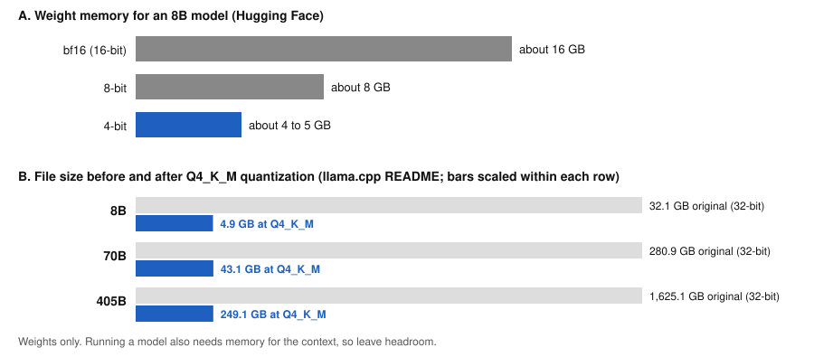

*Figure 21. Data: Hugging Face (8B model weights at three precisions) and llama.cpp's README (file sizes before and after Q4_K_M quantization). Weights only.*

**What quantization is.** Hugging Face: "Quantization stores a model's weights, and sometimes its activations, in fewer bits so the model needs less memory." llama.cpp, a popular tool for running models on ordinary computers: "Quantization reduces the precision of model weights (e.g., from 32-bit floats to 4-bit integers)." The trade-off, per Hugging Face: "Fewer bits cost some accuracy, and each quantization method makes a different tradeoff between memory, speed" and quality.

**Measured sizes from llama.cpp.** Its README lists original and quantized sizes. Note the "original" here is a 32-bit file, 4 bytes per parameter, which is why the 8B model is 32.1 GB rather than Hugging Face's 16 GB at 16 bits. The two sources agree once you account for precision.

| Model size | Original (32-bit file) | After Q4_K_M quantization |
|---|---|---|
| 8B | 32.1 GB | 4.9 GB |
| 70B | 280.9 GB | 43.1 GB |
| 405B | 1,625.1 GB | 249.1 GB |

The README also measures one model at many quantization levels. A few rows from it:

| Format | Bits per weight | Size | Text generation speed (tokens/s, their test) |
|---|---|---|---|
| F16 | 16.0005 | 14.96 GiB | 29.17 |
| Q8_0 | 8.5008 | 7.95 GiB | 50.93 |
| Q4_K_M | 4.8944 | 4.58 GiB | 71.93 |

Smaller files also ran faster in that test, because less data moves through memory per token.

**Research behind it.** The GPTQ paper (2022) showed post-training quantization working at very large scale: it "can quantize GPT models with 175 billion parameters in approximately four GPU hours, reducing the bitwidth down to 3 or 4 bits per weight, with negligible accuracy degradation," which allowed "for the first time" running "an 175 billion-parameter model inside a single GPU." QLoRA (2023) used 4-bit weights for training too, reducing "memory usage enough to finetune a 65B parameter model on a single 48GB GPU."

**Will it fit on my computer?** None of these sources talks about specific laptops, so treat this as an **estimate**, not a published spec. By the numbers above, an 8B model at 4 bits needs about 4 to 5 GB for its weights, which leaves room on a machine with 16 GB of memory. A 70B model at Q4_K_M is a 43.1 GB file, which would not fit in 16 GB and would need a machine with well over 43 GB. Running a model also needs memory beyond the weights (for the context, among other things), so leave headroom. llama.cpp's own note: "you will need adequate disk space to save them and sufficient RAM to load them."

**What this means in practice**

- **Parameters times bytes per parameter** gets you the weight memory. 2 bytes at 16-bit, about 1 at 8-bit, about half a byte at 4-bit.
- **4-bit is the common local choice** because it shrinks models about fourfold from 16-bit, but test quality on your own tasks.
- **Artificial Analysis flags quantization as a hidden variable** for hosted models too: "Some models use quantization to reduce computational requirements and increase speed. However, quantization can also affect model quality."

*Sources: [Hugging Face: Quantization overview](https://huggingface.co/docs/transformers/main/en/quantization/overview); [llama.cpp: quantize README](https://github.com/ggml-org/llama.cpp/blob/master/tools/quantize/README.md); [Frantar et al. 2022, GPTQ](https://arxiv.org/abs/2210.17323); [Dettmers et al. 2023, QLoRA](https://arxiv.org/abs/2305.14314); [Artificial Analysis: performance benchmarking](https://artificialanalysis.ai/methodology/performance-benchmarking).*

## 19. Open vs closed models

> **Key idea.** A closed model can only be used through its maker's service. An open-weights model lets you download the trained parameters. "Open source AI," as formally defined, asks for much more: enough information about the data and the full code to rebuild it.

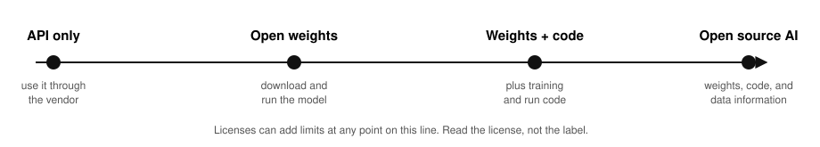

*Figure 22. Openness is a spectrum, not a yes-or-no.*

**What the formal definition asks for.** The Open Source Initiative's *Open Source AI Definition 1.0* says the preferred form for changing an AI system must include:

- **Data information:** "Sufficiently detailed information about the data used to train the system so that a skilled person can build a substantially equivalent system." That includes where the data came from and how it was selected, labeled, and filtered.
- **Code:** "The complete source code used to train and run the system."
- **Parameters:** the trained weights.

By that standard, most models marketed as "open" are **open weights**, not open source: you get the parameters, but not enough about the data or training code to rebuild them. Licenses can also limit commercial use or set conditions. Read the license, not the label.

**The policy view.** The US Commerce Department's NTIA reviewed openly released model weights in 2024. It concluded that "current evidence is not sufficient to definitively determine either that restrictions on such open weight models are warranted, or that restrictions will never be appropriate in the future." It recommended that the government "actively monitor a portfolio of risks" instead.

| | Closed (API only) | Open weights | Open source AI (OSI definition) |
|---|---|---|---|
| Can run on your own hardware | No | Yes | Yes |
| Can fine-tune it yourself | Only if the vendor offers it | Yes | Yes |
| Can see how it was trained | No | Usually not | Yes, through data information and code |
| Who fixes problems | The vendor | You or the community | You or the community |
| Typical reason to choose it | Top quality, no infrastructure to run | Data control, cost at scale, customization | Research, auditing, full reproducibility |

**What this means in practice**

- **Open weights make on-prem and local use possible** (Sections 17 and 18).
- **The gap between open and closed models changes over time.** Check current independent benchmarks instead of assuming (Section 13).
- **Ask exactly which kind of "open" you're getting** and what the license allows before building on it.

*Sources: [Open Source Initiative: Open Source AI Definition 1.0](https://opensource.org/ai/open-source-ai-definition); [NTIA: Dual-Use Foundation Models with Widely Available Model Weights](https://www.ntia.gov/programs-and-initiatives/artificial-intelligence/open-model-weights-report); [Artificial Analysis glossary](https://artificialanalysis.ai/methodology); [Singh et al. 2025, The Leaderboard Illusion](https://arxiv.org/abs/2504.20879).*

## Glossary

| Term | Plain meaning | Section |
|---|---|---|
| Abstention | The model declines to give a specific answer ("I don't know") | 12 |
| Adaptive thinking | The model decides per request whether and how much to think | 5 |
| Agent | A setup where the model decides its own next steps and tools, in a loop | 11 |
| Attention | The step where tokens update their meaning based on the words around them | 1 |
| Benchmark | A standard test used to compare models | 13, 14 |
| Blended price | Input, cached input, and output prices mixed into one number at a fixed ratio (7:2:1 cache hit:input:output at Artificial Analysis) | 7 |
| Compaction | Summarizing older context to free up space | 3, 9 |
| Contamination (test leakage) | Benchmark questions ending up in training data, inflating scores | 14 |
| Context engineering | Choosing everything that goes into the context window on each turn | 9 |
| Context rot | Recall and accuracy degrading as the context grows | 3 |
| Context window | The most tokens a model can work with in one request | 3 |
| Effort | A setting that steers how often and how deeply a reasoning model thinks | 5 |
| Embedding | A list of numbers representing meaning; similar meanings land close together | 8 |
| End-to-end time | Seconds from sending a request to receiving the final token | 7 |
| Endpoint / provider | A specific model offered by a specific host | 7 |
| Fine-tuning | Training an existing model further on new examples, which changes its weights | 4 |
| Function calling / tool use | The model asks the software around it to run a tool and reads the result | 10 |
| Hallucination | A plausible but false statement from a model | 12 |
| Harness | The software around a model: prompts, tools, memory, loop | 11 |
| Inference | Using a trained model to generate output | 4 |
| Jailbreak | A prompt injection aimed at making the model ignore its safety rules | 16 |
| Knowledge cutoff | The point after which the model's training data stops | 4 |
| LLM | Large language model: predicts the next token | 1 |
| MCP | Model Context Protocol: an open standard for connecting AI apps to tools and data | 10 |
| Open weights | The trained parameters can be downloaded | 19 |
| Output speed (tokens per second) | At Artificial Analysis since Nov 3, 2026: output tokens, including reasoning, per second over the whole request, so it includes the wait for the first token. Other sources may mean only the streaming part | 7 |
| Parameters / weights | The numbers inside the model that training adjusts | 4 |
| Pretraining | The first stage: learning to predict next tokens on huge amounts of text | 4 |
| Prompt injection | Text that hijacks a model's instructions, directly or hidden in content it reads | 16 |
| Quantization | Storing weights in fewer bits to save memory | 18 |
| RAG | Retrieval-Augmented Generation: find relevant text, add it to the context, answer from it | 8 |
| Reasoning tokens | Hidden working a reasoning model writes before answering; billed as output | 5 |
| RLHF | Reinforcement learning from human feedback: training from human rankings | 4 |
| Temperature | How sharp or flat the next-token odds are when picking | 6 |
| Thinking / reasoning model | A model trained (often with RL) to work through problems in many tokens before answering | 5 |
| Token | The chunk of text a model reads and writes | 2 |
| TTFT | Time to first token, of any kind (for reasoning models, the first reasoning token) | 5, 7 |
| Time to first answer token | Wait until the first token of the actual answer, including reasoning time | 5, 7 |
| Visual token | A patch of an image (28 by 28 pixels for Claude) counted as one token | 15 |
| Workflow | Model and tools run along fixed steps written in code | 11 |

## Not covered yet

These topics came up while building the guide, but the sources gathered don't support them well enough, so they're left out instead of guessed at:

- **Live leaderboard scores.** Who leads MMLU, GPQA, SWE-bench, HLE, or Terminal-Bench today. The leaderboards (arena.ai, tbench.ai) load their tables with JavaScript and no scores could be read reliably. The guide gives only each benchmark's launch-time numbers.
- **A trend in output speed over time.** No primary time series was found, and Artificial Analysis's method reset on Nov 3, 2026, so older speed numbers aren't comparable with new ones.
- **How audio and video are turned into tokens inside a model.** Only the list of supported inputs was sourced.
- **HELM's details** beyond its title and short description (its pages are rendered by JavaScript).
- **The exact month of Epoch AI's 2026 report.** The page gives the year (2026) but no readable date.
- **Specific laptops and how big a model they can run.** Section 18's fit example is arithmetic, labeled as an estimate.
- **Vendor contract terms:** data retention, training on customer data, regional processing.
- **Fine-tuning how-to and costs** for specific vendors.

## Sources

**Videos (checked against transcripts, Nov 11, 2026)**

- [Karpathy: Deep Dive into LLMs like ChatGPT](https://www.youtube.com/watch?v=7xTGNNLPyMI) (his most-watched video; source of the "lean on tools and tool use" quote)
- [Karpathy: How I use LLMs](https://www.youtube.com/watch?v=EWvNQjAaOHw)
- [Karpathy: Intro to Large Language Models](https://www.youtube.com/watch?v=zjkBMFhNj_g)
- [Karpathy: Let's build the GPT Tokenizer](https://www.youtube.com/watch?v=zduSFxRajkE)
- [3Blue1Brown: Transformers, the tech behind LLMs](https://www.3blue1brown.com/lessons/gpt/) (video and written lesson)

**University courses**

- [Stanford CS336: Language Modeling from Scratch](https://cs336.stanford.edu/)
- [MIT 6.S191: Introduction to Deep Learning](https://introtodeeplearning.com/)

**Vendor docs: OpenAI**

- [Understanding and counting tokens](https://help.openai.com/en/articles/4936856-what-are-tokens-and-how-to-count-them) (blocks automated fetch with HTTP 403; read via a web fetch service)
- [Models](https://developers.openai.com/api/docs/models)
- [Reasoning models](https://developers.openai.com/api/docs/guides/reasoning)
- [Prompt engineering](https://developers.openai.com/api/docs/guides/prompt-engineering)
- [Function calling](https://developers.openai.com/api/docs/guides/function-calling)
- [Embeddings](https://developers.openai.com/api/docs/guides/embeddings) (moved from platform.openai.com)
- [Images and vision](https://developers.openai.com/api/docs/guides/images-vision)
- [Safety in building agents](https://developers.openai.com/api/docs/guides/agent-builder-safety)
- [Why language models hallucinate](https://openai.com/index/why-language-models-hallucinate/) (blog, Sep 5, 2025; blocks automated fetch with HTTP 403; read via a web fetch service)

**Vendor docs: Anthropic**

- [Models overview](https://platform.claude.com/docs/en/models/overview)
- [Context windows](https://platform.claude.com/docs/en/build-with-claude/context-windows)
- [Thinking](https://platform.claude.com/docs/en/build-with-claude/thinking)
- [Steering thinking](https://platform.claude.com/docs/en/build-with-claude/thinking-steering-and-cost)
- [Extended thinking](https://platform.claude.com/docs/en/build-with-claude/extended-thinking)
- [Migrating to API version 2026-10-21](https://platform.claude.com/docs/en/api/migration-2026-10-21)
- [Prompt engineering overview](https://platform.claude.com/docs/en/build-with-claude/prompt-engineering/overview)
- [Tool use overview](https://platform.claude.com/docs/en/agents-and-tools/tool-use/overview)
- [Vision](https://platform.claude.com/docs/en/build-with-claude/vision)
- [Reduce hallucinations](https://platform.claude.com/docs/en/test-and-evaluate/strengthen-guardrails/reduce-hallucinations)
- [Mitigate jailbreaks and prompt injections](https://platform.claude.com/docs/en/test-and-evaluate/strengthen-guardrails/mitigate-jailbreaks)
- [Building effective agents](https://www.anthropic.com/research/building-effective-agents) (moved from /engineering/)
- [Effective harnesses for long-running agents](https://www.anthropic.com/research/effective-harnesses-for-long-running-agents) (moved from /engineering/)
- [Effective context engineering for AI agents](https://www.anthropic.com/research/effective-context-engineering-for-ai-agents)

**Vendor docs: Google, AWS, and tools**

- [Google: Gemini models](https://aistudio.google.com/docs/models)
- [Google: Long context](https://aistudio.google.com/docs/long-context)
- [Amazon Bedrock: Data protection](https://docs.aws.amazon.com/bedrock/latest/userguide/data-protection.html)
- [vLLM documentation](https://docs.vllm.ai/en/latest/)
- [Hugging Face: How to generate text](https://huggingface.co/blog/how-to-generate)
- [Hugging Face: Quantization overview](https://huggingface.co/docs/transformers/main/en/quantization/overview)
- [llama.cpp: quantize README](https://github.com/ggml-org/llama.cpp/blob/master/tools/quantize/README.md)

**Standards and specifications**

- [Model Context Protocol: Introduction](https://modelcontextprotocol.io/docs/getting-started/intro)
- [Model Context Protocol: Specification (revision 2026-07-28)](https://modelcontextprotocol.io/specification/latest)
- [OWASP: LLM01:2025 Prompt Injection](https://genai.owasp.org/llmrisk/llm01-prompt-injection/)
- [OWASP Top 10 for LLM Applications](https://genai.owasp.org/llm-top-10/)
- [Open Source Initiative: Open Source AI Definition 1.0](https://opensource.org/ai/open-source-ai-definition)
- [NTIA: Open model weights report](https://www.ntia.gov/programs-and-initiatives/artificial-intelligence/open-model-weights-report) (moved)

**Benchmarks and measurement**

- [Artificial Analysis: performance benchmarking methodology](https://artificialanalysis.ai/methodology/performance-benchmarking) (v3.0.0, Nov 3, 2026)
- [Artificial Analysis: methodology and glossary](https://artificialanalysis.ai/methodology)
- [Artificial Analysis: Intelligence Benchmarking](https://artificialanalysis.ai/methodology/intelligence-benchmarking) (Index v5.0.1)
- [Stanford HELM](https://crfm.stanford.edu/helm/)
- [Arena leaderboard](https://arena.ai/) (formerly lmarena.ai)
- [Humanity's Last Exam](https://lastexam.ai/)
- [Terminal-Bench](https://www.tbench.ai/)
- [Epoch AI 2026, The plunging price of thought](https://epoch.ai/publications/the-plunging-price-of-thought)
- [Epoch AI 2025, LLM inference prices have fallen rapidly but unequally across tasks](https://epoch.ai/data-insights/llm-inference-price-trends)

**Papers**

- [Lewis et al. 2020, Retrieval-Augmented Generation for Knowledge-Intensive NLP Tasks](https://arxiv.org/abs/2005.11401)
- [Hendrycks et al. 2020, Measuring Massive Multitask Language Understanding (MMLU)](https://arxiv.org/abs/2009.03300)
- [Radford et al. 2021, Learning Transferable Visual Models From Natural Language Supervision (CLIP)](https://arxiv.org/abs/2103.00020)
- [Ouyang et al. 2022, Training language models to follow instructions with human feedback](https://arxiv.org/abs/2203.02155)
- [Frantar et al. 2022, GPTQ](https://arxiv.org/abs/2210.17323)
- [Dettmers et al. 2023, QLoRA](https://arxiv.org/abs/2305.14314)
- [Zheng et al. 2023, Judging LLM-as-a-Judge with MT-Bench and Chatbot Arena](https://arxiv.org/abs/2306.05685)
- [Jimenez et al. 2023, SWE-bench](https://arxiv.org/abs/2310.06770)
- [Sainz et al. 2023, NLP Evaluation in trouble](https://arxiv.org/abs/2310.18018)
- [Yang et al. 2023, Rethinking Benchmark and Contamination for Language Models with Rephrased Samples](https://arxiv.org/abs/2311.04850)
- [Rein et al. 2023, GPQA](https://arxiv.org/abs/2311.12022)
- [Chiang et al. 2024, Chatbot Arena](https://arxiv.org/abs/2403.04132)
- [DeepSeek-AI 2025, DeepSeek-R1](https://arxiv.org/abs/2501.12948)
- [Phan et al. 2025, Humanity's Last Exam](https://arxiv.org/abs/2501.14249)
- [Singh et al. 2025, The Leaderboard Illusion](https://arxiv.org/abs/2504.20879)
- [Kalai et al. 2025, Why Language Models Hallucinate](https://arxiv.org/abs/2509.04664)
- [Merrill et al. 2026, Terminal-Bench](https://arxiv.org/abs/2601.11868)

**Measured for this guide:** token counts with `tiktoken` (o200k_base, cl100k_base), Nov 11, 2026.

**Reviewed, not cited:** popular "AI explained" posts on X (Oct 2026 search). They were short glossary posts with no sources.
